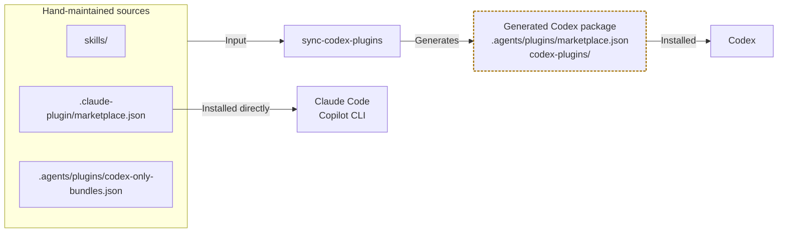

# misty-marketplace

Current version: [v2.0.0](release-note/v2.0.0.md)

把 Aery Lin 的開發經驗與工程慣例整理成可重複使用的 AI Agent Skills，依情境打包成 Plugin Bundle 發布。

## Table of Contents

- [開始使用](#開始使用)
- [專案概覽](#專案概覽)
- [Plugin Bundle](#plugin-bundle)
- [維護流程](#維護流程)

---

## 開始使用

- marketplace 名稱是 `misty-plugins`；以下以 `misty-work` 為例，安裝其他 bundle 時替換名稱。
- 在本 repo 根目錄測試時，可把 `Aery9527/misty-marketplace` 換成 `.`。
- 官方說明：[Claude Code plugin marketplaces](https://code.claude.com/docs/en/discover-plugins)、
  [Copilot CLI plugins](https://docs.github.com/en/copilot/how-tos/copilot-cli/customize-copilot/plugins-finding-installing)、
  [Codex plugins](https://developers.openai.com/codex/plugins)。

Claude Code：

```text
/plugin marketplace add Aery9527/misty-marketplace
/plugin install misty-work@misty-plugins
/reload-plugins

# 更新
/plugin marketplace update misty-plugins

# 移除 marketplace，同時移除從它安裝的 plugins
/plugin marketplace remove misty-plugins
```

GitHub Copilot CLI：

```sh
copilot plugin marketplace add Aery9527/misty-marketplace
copilot plugin install misty-work@misty-plugins

# 更新
copilot plugin update --all

# 移除
copilot plugin uninstall misty-work
copilot plugin marketplace remove misty-plugins
```

Codex：

```sh
codex plugin marketplace add Aery9527/misty-marketplace

# 進入 codex 後用 /plugins 安裝或停用 plugin
codex

# 更新
codex plugin marketplace upgrade misty-plugins

# 移除
codex plugin marketplace remove misty-plugins
```

[Back to top](#table-of-contents)

---

## 專案概覽

- [skills](skills) 是所有 skill 的原始內容；每個 skill 的名稱、用途與觸發時機寫在各自 `SKILL.md` 的 frontmatter。
- `SKILL.md` 是英文主檔，同目錄的 `*_ch.md` 是繁體中文版本。
- [.claude-plugin/marketplace.json](.claude-plugin/marketplace.json) 宣告所有 host 都能安裝的 bundle，也保存整個 repo 共用的版本號。
- [.agents/plugins/codex-only-bundles.json](.agents/plugins/codex-only-bundles.json) 宣告只有 Codex 能安裝的 bundle。
- [.agents/plugins/marketplace.json](.agents/plugins/marketplace.json) 與 [codex-plugins](codex-plugins) 是同步腳本產生的 Codex 封裝，只含英文主檔。
- 給 AI agent 的工作規則看 [LORE_ch.md](LORE_ch.md)。



[Back to top](#table-of-contents)

---

## Plugin Bundle

- Bundle 是依情境組合的一組 skills；每個 bundle 包含哪些 skills，以宣告它的 catalog 為準。

| Bundle         | 宣告位置                                                                           | 可安裝的 host                       |
|----------------|------------------------------------------------------------------------------------|-------------------------------------|
| `misty-work`   | [.claude-plugin/marketplace.json](.claude-plugin/marketplace.json)                 | Claude Code、GitHub Copilot CLI、Codex |
| `misty-dev`    | [.claude-plugin/marketplace.json](.claude-plugin/marketplace.json)                 | Claude Code、GitHub Copilot CLI、Codex |
| `misty-claude` | [.agents/plugins/codex-only-bundles.json](.agents/plugins/codex-only-bundles.json) | Codex                               |

[Back to top](#table-of-contents)

---

## 維護流程

- 修改 [skills](skills) 或任一份 bundle catalog 後，必須執行同步腳本更新 Codex 封裝：

```powershell
.\scripts\sync-codex-plugins.ps1
```

- 腳本會讀寫哪些檔案、前置條件與失敗行為，看 [scripts/README.md](scripts/README.md)。
- 嚴禁直接編輯 [codex-plugins](codex-plugins) 底下的 skill 副本；下次同步會覆蓋。
- 提交用 `commit` skill，發版用 `release` skill，兩者都在 [.claude/skills](.claude/skills)。

[Back to top](#table-of-contents)
