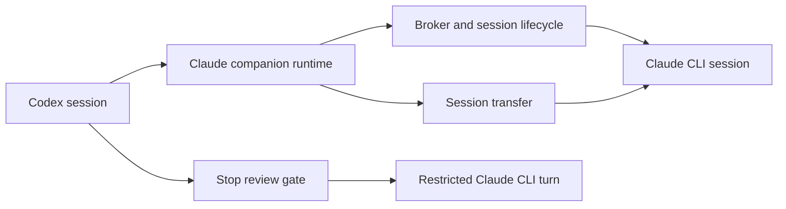

# Claude Code Bridge Runtime

- `parts`:
    - [Broker 與 session lifecycle](../sd-broker-session-lifecycle.md): 協調 live bridge session、graceful interruption 與 session cleanup，並以 job record 作為狀態來源。
    - [Session transfer](../sd-session-transfer.md): 將 Codex context 轉換成 bridge-owned Claude session，並回傳可續接命令。
- `depends`:
- `tags`: `claude-bridge`

## 快速導覽

- [此組裝提供的成果](#此組裝提供的成果)
- [關係與資料流](#關係與資料流)

---

## 此組裝提供的成果

Bridge runtime 讓 Codex session 能把工作委派給長期運行的 Claude Code CLI
session、安全地觀察與停止委派工作、選擇性要求停止前審查，並把產生的脈絡交給可續接的
Claude session。它如實回報各機制實際帶有的 host 限制，不會宣稱 CLI 其實無法提供的
Claude Code 原生行為。

[返回頂端](#快速導覽)

---

## 關係與資料流

Companion 維持所有使用者呼叫 bridge commands 的單一邊界。Codex hooks 是獨立的 host
entry points。Stop hook 直接呼叫自己的受限 Claude turn，session hook 協調 teardown。
*Broker 與 session lifecycle* 負責 live session 協調，*Session transfer* 透過 Claude CLI
建立另一個可續接的 bridge-owned session，不直接寫入 Claude 的私有 project-session 格式。
Foreground command 保留 stdout 給最終結果，並從 stderr 顯示即時 Claude protocol
progress；background worker 則只把相同進度寫入 job log 與 phase。

- [Stop review hook](../scripts/stop-review-gate-hook.mjs) 將已儲存的 review-gate 偏好套用到 Codex stop event。未啟用時保持靜默。啟用後若缺上一則助理回覆或 Claude 未就緒，略過審查並提示。呼叫 reviewer 後若審查失敗或決定無效，要求 Codex 繼續。

[返回頂端](#快速導覽)
