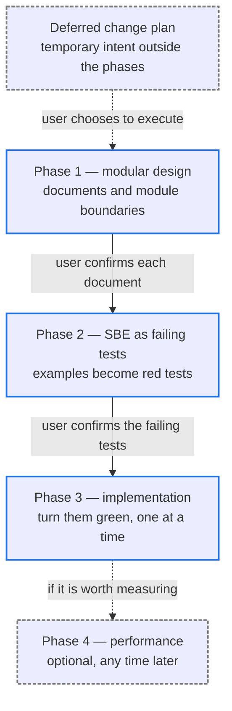
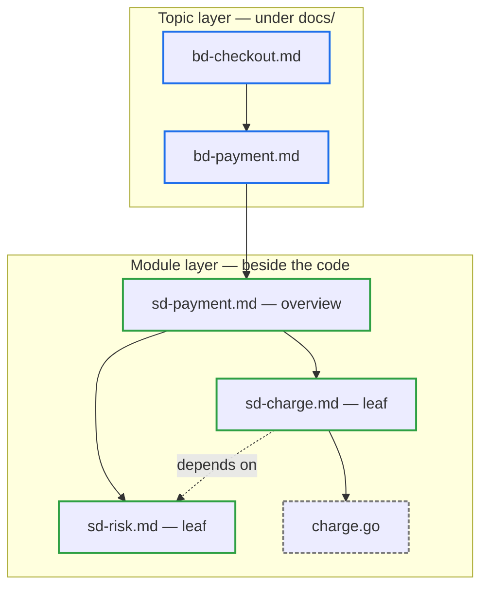

# code-mereology

A development workflow whose only specification document is a design document.
Its durable outputs are tests, implementation code, and an optional performance
record; a temporary deferred-change plan may hold work intended for later. It
takes its name from mereology, the study of part-whole relations — the
difference between a module being part of something and merely depending on it
runs through its entire document model.

## Quick Navigation

- [What Problem It Solves](#what-problem-it-solves)
- [The Four Phases](#the-four-phases)
- [Document Model](#document-model)
- [File Naming](#file-naming)
- [Decisions Worth Knowing](#decisions-worth-knowing)
- [Where The Rules Live](#where-the-rules-live)

---

## What Problem It Solves

Design documents rot. They describe how something works, the code moves on, and
a year later nobody trusts the document enough to read it.

This skill's answer is to give the document less to be wrong about. A design
document states what a module does, what it owns, and what to watch out for —
never how it does it. Interfaces are Markdown links into the real code rather
than copies of it. Behavior is pinned by tests rather than prose. What remains
in the document is the part that changes slowly.

There is no durable implementation-plan or standalone SBE document. A temporary
`sd-*-plan.md` may preserve one or more proposed changes, as separate entries,
while they are deferred, but none is current design or confirmed
specification, and each is deleted after its own delivery. Frozen examples
live only in failing tests, which cannot drift from the code without turning
red.

[Back to top](#quick-navigation)

---

## The Four Phases

Each phase is loaded on its own. A phase states what it needs before starting
and what it produces, so any one of them can be picked up cold.

The two solid arrows are user gates. Nothing proceeds past them on the agent's
own judgement: the user confirms every document before its modules are opened,
and confirms the failing tests before a line of implementation is written.

Phases 2 and 3 run once per leaf module, not once per tree.

[Back to top](#quick-navigation)

---

## Document Model

Documentation descends through two layers. A topic layer says what the assembled
whole delivers; a module layer says what one component does and where its
boundary lies. Readers enter through a topic and descend into components.

- Solid arrows between documents are composition. The dashed arrow is a dependency. `sd-charge.md` stays a leaf because it needs risk checking as a capability.
- The arrow from a leaf to code is an interface link in the body. [list-relations.mjs](scripts/list-relations.mjs) follows the links between documents in their headers. Phase 3 uses it in reverse to find affected parents and dependents.

[Back to top](#quick-navigation)

---

## File Naming

| Name | Lives | Subject |
|------|-------|---------|
| `bd-<topic>.md` | `docs/` at a scope root | What the assembled whole delivers — a business requirement, an architectural account, an end-to-end data flow |
| `sd-<feature>.md` | Beside the code it describes | One module: its responsibility, boundary, and caveats |
| `sd-<feature>-plan.md` | Beside its existing design document | Temporary work intended for later, one or more `---`-separated entries per file; outside the document graph, each entry deleted after its delivery |
| `sd-<feature>-perf.md` | Beside the code it measures | The three most recent performance measurements, each pinned to a commit |
| `docs/code-mereology.json` | Repository root | One tag table and directory exclusions for the document scan |

A monorepo nests the same model: one `docs/` at the repository root for how
submodules assemble, plus one at each submodule root for its own internals.

[Back to top](#quick-navigation)

---

## Decisions Worth Knowing

These are the choices most likely to surprise someone reading the rules for the
first time.

**Frozen examples live only in tests.** A deferred entry may carry provisional
examples as proposal input, but Phase 2 revalidates them and writes the confirmed
cases as failing tests. That entry is then deleted rather than becoming a second
source of truth.

**Deferred plans are intent, not specification.** They may remain unlinked and
wait until the user chooses to execute them. Execution still passes through the
normal design and test gates; once the work and design documents agree, the
entry is deleted.

**A plan entry leads with why, not just what.** A design document keeps
attracting change requests after delivery, so one plan file may hold several
`---`-separated entries recorded at different times. Each opens with the
requirement that prompted it — the delta alone can't tell a later reader
whether it's still worth doing once the situation behind it is forgotten.

**A design document is capped at 300 lines, diagrams excluded.** Going over is
read as the module carrying too much, and the only permitted response is
splitting it — compressing the prose to fit is explicitly forbidden.

**The user prunes the tests, not a checklist.** Judging concrete inputs and
outputs is easier than judging abstract descriptions of them, so what gets
reviewed is the tests themselves rather than a list of cases to tick off.

**Every test file names its design document in a header comment.** Inferring the
owner from what sits next to the code works right up until a folder gains a
second design document, and then it breaks silently.

- **An existing module gets documented one capability at a time.** A new use of an undocumented module starts with a partial leaf covering only the capability needed. Phase 2 can use only covered capabilities. Once the final capability is covered, remove the marker and connect the document to a topic.
- **Relationships are declared in headers.** `parts` identifies composition. `depends` identifies a required capability or topic outcome. The reason beside a link helps readers decide which documents to open.
- **Tags follow composition.** A tag declared on a topic applies to its descendants. Inherited tags let a query find module documents without repeating tag declarations.

[Back to top](#quick-navigation)

---

## Where The Rules Live

This file is an overview. The rules an agent actually follows are in
[SKILL.md](SKILL.md) and the phase references it routes to:

- [Phase 1 — Modular Design](references/phase1-design.md)
- [Phase 2 — SBE As Failing Tests](references/phase2-sbe.md)
- [Phase 3 — Implementation](references/phase3-tdd.md)
- [Phase 4 — Performance Verification](references/phase4-benchmark.md)

- [count-lines.mjs](scripts/count-lines.mjs) checks the line limit.
- [list-planned.mjs](scripts/list-planned.mjs) finds links to targets that do not exist yet.
- [list-plans.mjs](scripts/list-plans.mjs) finds deferred plans.
- [list-relations.mjs](scripts/list-relations.mjs) validates the document graph and queries links and tags.

[Back to top](#quick-navigation)
