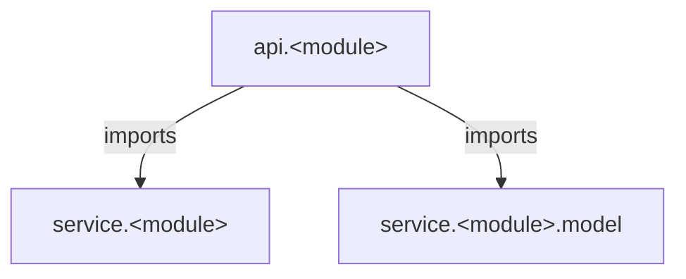

# Phase 1 — Modular Design

Concept definitions for the `bd-*.md` and `sd-*.md` layers live in
[Document Model](../SKILL.md).

## Purpose

Turn a feature request into design documents that carve the feature into modules
with high cohesion and clear boundaries. Success means every branch of the
document tree ends in a leaf the user has confirmed and Phase 2 can consume.

## SD Role Determination

This section governs a design document only; a `bd-*.md` carries no role, and neither a `-perf` record nor a `-plan` file is this phase's design output. MUST decide the role before writing a single line.

- If the document describes how sub-modules assemble into a larger concept and its substance is links to other design documents, its role is overview.
- If the document describes one module's own behavior and links to the target code, its role is leaf.
- Decide the role by responsibility. Use `parts` for the child modules of an overview, and `depends` for the capabilities a leaf needs.
- If it both carries its own concrete behavior and is made up of sub-modules, the role is overview and that behavior MUST be pushed down into child leaf documents.

## Location Decision

This section plans the graph — which nodes exist and which edges join them. Nothing is written here; Recursion And Gates does the writing, one confirmed node at a time.

1. Identify the folder that holds — or will hold — the corresponding code.
2. Place `sd-<feature-name>.md` in that folder. MUST NOT collect design documents under `docs/`.
3. Work out which scope owns each module: the submodule holding its code, or the repository itself in a single-repo project. A feature spanning submodules owns modules in several scopes at once. Every `sd-*.md` still lives with the code it describes — MUST NOT create a root `sd-*.md` just because a feature spans submodules.
4. Each scope keeps its assembly documents in the `docs/` at its own root. A single-repo project has exactly one such directory, at the repository root; a monorepo has one at the repository root plus one at each submodule root. `docs/` MUST NOT exist at any level in between. Note which scopes still need one; the directory itself appears when that scope's first `bd-*.md` is written.
5. In every scope that owns one of these modules, name the `bd-*.md` whose topic the module takes part in — an existing one, or a new `bd-<topic-name>.md` named after what the assembled whole delivers rather than after the module itself. Each of them gets an edge to that module's `sd-*.md`. A module taking part in several topics is reached from each of them — a component serves more than one assembly.
6. If the feature spans submodules, the repository-root `bd-*.md` for the topic gets an edge to each submodule `bd-*.md` taking part, and never past them into their modules. An edge points at a document, not a directory — Phase 3 walks these in reverse, and a directory is not a node it can follow.
7. List dependencies between leaves and between assemblies on the same abstraction level. A leaf depends on capabilities supplied by another leaf. An assembly depends on results delivered by another topic. These results may come through code, files, or a manual workflow. Overview documents compose their children and do not declare or receive dependencies.
8. If a dependency points at a leaf whose document does not exist yet, how that leaf enters depends on whether its code exists. Code that does not exist yet MUST be planned into the composition tree of whichever scope owns it, so a confirmation path reaches it. Code that already exists enters as a partial leaf instead — see Partial Leaf below. A dependency edge alone never brings a node into being.
9. Follow the dependency edges for cycles. A cycle MUST be shown to the user before anything is written — it usually means a shared contract wants extracting or a responsibility sits on the wrong side of a boundary. Keeping one is the user's explicit call, never the agent's default.
10. Leaf dependencies and dependencies between submodule assemblies MAY cross submodule boundaries. Root and submodule assemblies MUST NOT have a dependency edge between them. A root assembly reaches participating submodule modules through their own assembly documents.
11. The result is a list of nodes to write and edges to add. Carry it into Recursion And Gates.

- Before changing an existing document, use `-a <document> <repository-root>` and consider the directly related documents. To find topics, use the repository tag table to choose a tag, query `-t <tag> <repository-root>`, and use `-a` for a candidate's relations. Follow [Query and Adoption](../SKILL.md#query-and-adoption) for the script path and failure behavior.
- For all three document kinds below, use [Header and Tags](../SKILL.md#header-and-tags). In the body, use the exact header label as `*label*` when mentioning another design document. During review, check reference-style links and assembly abstraction levels against the document rules.

## Writing Rules — Assembly Document

- MUST organize the document in this order: header, what the assembly delivers, then the relationship and data-flow diagram. Body sections that do not apply MAY be omitted. MUST keep the order.
- MUST take the assembled whole as its subject: what a business requirement delivers, how an architecture holds together, where an end-to-end data flow runs. The reader arrives wanting the outcome, not the parts list.
- The Mermaid diagram MUST show only structural roles and the rules governing their relationships and data flow. MUST use placeholder names such as `api.<module>` for roles. The diagram MUST NOT enumerate concrete packages or modules.
- Diagram arrows for code dependencies MUST correspond to code relationships such as imports. Identify unimplemented arrows as patterns and state the expected relationship. For topic dependencies delivered outside code, show the delivery direction and its result.
- Header `parts` MUST identify the concrete nodes one level down. For each, describe its role in the assembly. A cross-submodule root assembly links to each participating submodule assembly. Other assemblies link to participating module documents in their scope. For each `depends` item, state the outcome expected from that topic.
- When adding an instance of an existing role under the same rules, MUST update only `parts`. A change to the diagram MUST reflect a change to a role type or a relationship rule.
- In Mermaid labels, MUST escape literal `<` and `>` as `#lt;` and `#gt;` so the renderer displays them as text.
- MUST NOT sink into how any single module behaves internally — that belongs to the `sd-*.md` it links to. A `bd-*.md` explaining one module's rules has become a design document in the wrong place.
- Carries no line limit; the 300-line rule binds design documents only, and never a `-perf` record.

- Example — Each API package imports the service and service model for the same module. Adding `orders` under these rules adds its design document links without changing the diagram.



## Writing Rules — Leaf

- MUST organize the document in this order: header, responsibility and boundary, diagram, interfaces and data views, then caveats. Body sections that do not apply MAY be omitted. MUST keep the order.
- MUST state what the module does, what it owns, and what it deliberately does not own.
- MUST state the caveats: idempotency, concurrency, ordering, failure behavior, and limits.
- MUST use Mermaid whenever the document describes a relationship among two or more components, a multi-step data flow, or a state transition. MUST NOT add a diagram when there is no relationship to show.
- MUST express every interface and data view as a Markdown link to the target code. See Interface Links below for code that does not exist yet.
- Declare each required leaf in `depends`, explain the capability needed, and show that dependency in the relationship diagram. Keep `parts` empty.
- MUST NOT contain code blocks other than Mermaid.
- MUST NOT duplicate algorithms, control flow, or field-level structure. MAY name one current implementation or implementation constraint when that choice materially defines the module boundary, the observable behavior, or a compatibility contract — and MUST link to it rather than restate it.

## Writing Rules — Overview

- MUST organize the document in this order: header, concept, then the composition diagram. Body sections that do not apply MAY be omitted. MUST keep the order.
- MUST describe the abstract concept and how the child modules compose into it.
- MUST use Mermaid for composition, dependency, and data flow.
- MUST list every child design document in `parts` and describe its role. Keep `depends` empty.
- MUST NOT restate the behavior a child document already owns.

## Partial Leaf

A repository already under development holds modules with no design document.
When a new feature depends on one, documenting that whole module first is
unbounded work standing between the feature and its first line of code. A
partial leaf is the bounded alternative: it describes only the capability being
depended on, so the dependency has a real document to link to today and the rest
of the module is described when someone is next working in it.

- MUST follow the leaf writing rules for the capability it covers — responsibility, boundary, caveats, interface links — and MUST NOT describe the module's other behaviors at all. Covering everything is what this section exists to avoid.
- MUST carry, immediately under the title, a marker line listing the capabilities it covers and stating that the rest is not: `` > `code-mereology-partial`: covers <capability>, <capability>; this module's other behavior is not described yet. `` A reader can then tell a boundary from a blind spot, and the phase responsible for clearing it can find every one by search. Place the header immediately after the marker.
- Every capability it takes on — the one it is created for, and each one added later — MUST be read out of the code it describes. MUST NOT infer behavior from what the depending module expects to be true: a contract written from the caller's hope reads as a fact and is worse than no document at all. This binds the capabilities entered because something depends on them; once the module itself is what is being designed, it is an ordinary leaf describing what is being built, like any other.
- Its interface links point at code that already exists, so they MUST resolve immediately and MUST NOT carry `(planned)`. That marker means the target does not exist, which is never the case here.
- MUST live beside the code it describes like any other leaf, and MUST NOT take a distinguishing filename suffix. The marker is what makes it partial; a suffix would have to be renamed at completion, breaking every link and every test header pointing at it.
- When a later dependency needs a capability the marker still excludes, MUST extend that same document with it and add it to the marker's list. MUST NOT open a second `sd-*.md` alongside it for one module, and MUST NOT take the occasion to describe everything else — it grows one capability at a time, as each one is actually depended on.
- The 300-line limit and the split procedure apply to it unchanged. A split is not the second document forbidden above: each child takes the marker only where behavior of its own is still undescribed, and the promoted overview carries none, because it describes composition rather than behavior.
- MUST leave `parts` and `depends` empty. Its role is to record the capabilities it provides to dependents. This keeps a partial leaf from expanding into the internal dependencies of a legacy system.
- When introducing a partial leaf, add its `parts` edge from an appropriate existing assembly in its scope. If no appropriate assembly exists at entry, MUST NOT create one solely for the partial leaf.
- Extend the partial leaf in Phase 1 when Phase 2 needs an excluded capability. When the final capability is described, remove the marker. On removal or promotion, connect the resulting leaf or overview along `parts` to an appropriate assembly in the same Phase 1. Confirm a new assembly with the user if none exists. Keep any new assembly scoped to the conversion.

## Interface Links

- If the target code already exists, the link MUST point at the actual file or symbol.
- If the target code does not exist yet, the link is a planned path. A planned path is a temporary location marker, not an interface definition — it MUST NOT be treated as one.
- For planned paths, this phase MUST confine itself to behavior boundaries, input and output semantics, and ownership. The exact interface is created by Phase 2 as part of the minimum skeleton, and Phase 2 resolves the link before its confirmation gate.
- Every planned link MUST carry `(planned)` immediately after it: a link written as `[OrderValidator](internal/order/validator.go)`, then the marker, with a single space between them at most. A later reader can then tell a promise from a fact. Phase 2 drops the marker when it resolves the link.
- Run [list-planned.mjs](../scripts/list-planned.mjs) — the same `<skill-root>/scripts/` directory as the counter below — to list the open promises in a document. It reports only a marker that follows a Markdown link, so the word appearing in ordinary prose is never mistaken for one.

## Line Counting

- Counted lines = total file lines minus every line inside a `mermaid` fenced block, fence lines included. Blank lines, headings, frontmatter, and link-only lines all count.
- Mermaid blocks MUST use exactly three backticks and the lower-case `mermaid` info string, and MUST start in column one. Four-backtick fences, tilde fences, and diagrams indented inside a list item or blockquote MUST NOT be used — the counter reads anything else as ordinary text, which inflates the count rather than hiding lines from it, and a large diagram reads poorly inside a container anyway.
- Run [count-lines.mjs](../scripts/count-lines.mjs) from this skill, passing one or more document paths. It prints `<count>` and the path per file, and exits non-zero on a Mermaid block that is never closed.
- The script lives at `<skill-root>/scripts/count-lines.mjs`, where `<skill-root>` is the directory holding this skill's `SKILL.md` — the parent of the `references/` directory this file sits in. MUST resolve that path from where this file was loaded from, and MUST NOT hard-code an installation path: the skill is distributed as a plugin and lands wherever the host installs it.

```bash
node <skill-root>/scripts/count-lines.mjs path/to/sd-feature.md
```

- MUST count after every write and every revision.

## Split Procedure

Triggered when a document exceeds 300 counted lines.

1. MUST NOT lower the count by deleting caveats, compressing prose, or moving text into Mermaid. Splitting the module is the only permitted response.
2. Find the seams by responsibility and by data-flow boundary — group content that changes for the same reason.
3. Promote the document to overview and update `parts` to list the child documents placed beside their code. Keep any tag that applies to all children on the overview.
4. Move incoming `depends` edges to the child leaves providing the original contracts. Move outgoing `depends` edges to the child leaves that require those capabilities. The overview MUST keep `depends` empty.
5. Recurse into this phase for every child document.

## Promotion Lifecycle

If a promoted document already passed Phase 2 and Phase 3, its existing tests and
code stay valid and MUST be re-anchored to whichever child leaf now owns them.
Promotion alone MUST NOT trigger a rewrite of any test or implementation.

## Recursion And Gates

Walk the planned graph downward, one node at a time. All writing happens here, and never ahead of a confirmation.

1. At a `bd-*.md` node, write the header and body. Mark an edge to a planned document with `(planned)` until the target exists.
2. Present that document and obtain confirmation. The user is the one who knows whether the outcome and the assembly are right, so MUST NOT write any child node before that confirmation. A module taking part in several topics means several `bd-*.md` to confirm, each on its own.
3. Descend to each child `bd-*.md` and repeat from step 1, until the nodes below are modules rather than topics.
4. At an `sd-*.md` node, write the header and body and count its lines. If it exceeds the limit, MUST run the split procedure.
5. Present that document and obtain confirmation. MUST NOT write any child before that confirmation.
6. Descend to each child `sd-*.md` and repeat from step 4.
7. Stop descending when a node is at or under 300 counted lines and describes concrete module behavior rather than composition. That node is a leaf.
8. As each node is written, update the header entries that reference it and remove `(planned)` from links whose target now exists. Update assembly diagrams only when role types or relationship rules change. Keep module diagrams consistent with their leaf or overview role.
9. A partial leaf is written and confirmed in the same run as the leaf that depends on it. It is reached through that dependency rather than by descending from a parent, and that MUST NOT leave it unconfirmed — the user has to agree it describes the existing code correctly.
10. Declare a tag at the highest applicable node. Add each new tag and its description to the repository's `docs/code-mereology.json` and confirm it with the user along with the documents. Remove a tag from the table when its last declaration is removed.

## Exit Artifacts

- One or more `sd-*.md`, each confirmed by the user at its own level.
- Every `bd-*.md` on the path has current `parts` and a Mermaid diagram reflecting the current roles and relationship rules. The user has confirmed each document at its level.
- No `(planned)` marker left on any edge along the path — every planned node now exists. Verify with [list-planned.mjs](../scripts/list-planned.mjs): entries pointing at a `.md` document MUST be gone, while entries pointing at code stay until Phase 2 builds the interface.
- Every branch terminated in a leaf, so Phase 2 has a valid input. A partial leaf entered for code that already runs is finished for this phase too, but it is not the input this run produced — Phase 2 goes to the leaf the feature is being built in.
- [list-relations.mjs](../scripts/list-relations.mjs) passes at the repository root with no query options. Follow [Query and Adoption](../SKILL.md#query-and-adoption) on failure.
