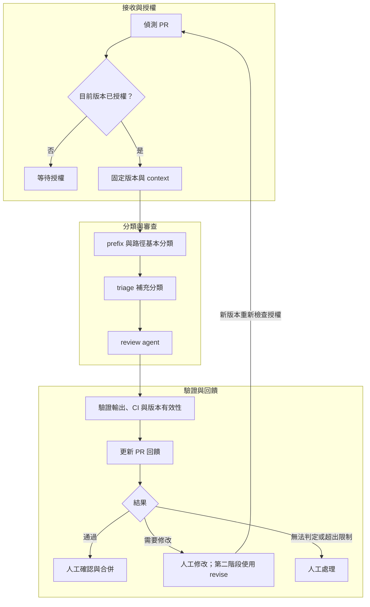

# misty-pr 自動化 PR 流程計畫

- 本計畫描述預計新增的 plugin、責任邊界與分階段交付方式；所列能力均為待實作內容，不代表目前 marketplace 已提供。
- 目標是以 Python 串接 PR 偵測、分類、審查與後續修正，讓各節點的判斷品質能透過 skill 持續改善。
- skill 負責語意判斷；runtime 負責授權、執行權限、版本一致性、持久狀態與預算。這些控制不能只靠 prompt 保證。

## 目錄

- [範圍與分工](#範圍與分工)
- [處理流程](#處理流程)
- [設定與資料契約](#設定與資料契約)
- [授權與執行邊界](#授權與執行邊界)
- [狀態與失敗處理](#狀態與失敗處理)
- [自動修正循環](#自動修正循環)
- [發行與部署](#發行與部署)
- [里程碑與驗收方向](#里程碑與驗收方向)

## 範圍與分工

- plugin 建議名稱為 `misty-pr`，第一版先支援 GitHub、單機輪詢與單 worker，不建立多平台或分散式排程框架。
- 第一版完成自動審查與回饋，由人修改及合併；第二階段加入自動修正及重審，第三階段另行設計自動合併。
- 第一版以 feature、bugfix、security 等 review profile 區分審查重點，不先為每種分類拆出獨立 skill。

| 元件 | 責任 | 輸出與邊界 |
|---|---|---|
| `code-pr-submit` | 準備並提交 PR，交代目的、變更、驗證與風險 | 格式完整的 PR；不取得自動處理的授權決策權 |
| `code-pr-triage` | 依 branch、diff、路徑、目的與可信規則細分類 | 允許的 review profiles、理由及證據；不自行執行命令 |
| `code-pr-review` | 依 profiles 審查需求、程式與驗證證據 | 結構化結論與 findings；不持有發布或合併權限 |
| `code-pr-revise` | 第二階段依已確認 findings 修改程式 | patch 與驗證證據；不自行核准或合併 |
| Python runtime | 偵測、授權、固定 snapshot、啟動 agent、驗證結果與發布 | 執行紀錄及 PR 回饋；唯一持有流程控制與發布權限的元件 |

[回到目錄](#目錄)

---

## 處理流程

- 輪詢必須處理分頁與 API 限流；draft 及已關閉 PR 不執行審查，重新開啟後重新檢查狀態與授權。
- branch prefix 只提供粗分類。路徑規則建立不可刪減的審查基線，triage 只能從允許清單追加 profile，或轉交人工。
- 未授權的 PR 保留在 GitHub，但 runtime 不呼叫模型，也不因 PR 自帶的文字、label 或 branch 名取得執行權限。

[回到目錄](#目錄)

---

## 設定與資料契約

| 設定類別 | 預計內容 | 範例或限制 |
|---|---|---|
| repository 與可信 base | 允許處理的 repository，以及可信規範來源的 base refs | 不在允許清單的 base 轉交人工 |
| 基本路由 | prefix 與檔案路徑規則 | `feat/*` 對應 feature；`fix/*` 對應 bugfix |
| 強制加審 | 敏感範圍對應的 profiles | 修改認證流程必須加入 security |
| agent profile | 核准執行檔、固定參數、skill 與輸出契約 | agent 不得根據 PR 內容挑選任意命令或 skill |
| context | 必須提供的資料、來源與大小上限 | 缺少必要證據或超限時不能宣稱完整通過 |
| 執行限制 | 每步時限、每 PR 預算、重試與動作範圍 | 技術失敗最多追加兩次重試 |

- context 必須包含 repository 與 PR 身分、head/base SHA、branch、宣告目的、受限 diff 與必要檔案內容、可信 base 的規範與設計、CI 結果，以及資料庫中的前輪 findings。
- 執行紀錄必須保存 runtime、CLI、skill、policy 與設定的版本或摘要，以追溯當輪採用的規則。
- PR body、comments 與程式內容均屬不可信資料，嚴禁將其中的指令提升為 runtime 或 agent 的控制規則。
- 結果使用獨立的 versioned JSON 契約，表達 `pass`、`changes_requested` 或 `needs-human`，並附 findings 的定位與證據、reviewed head/base 及 profiles。
- runtime 必須核對結果與實際 snapshot；嚴禁只因 exit code 為零或 agent 宣稱 SHA 相符，就視為審查通過。
- 完整欄位、schema 與可執行驗收案例在詳細設計階段定義，本計畫中的例子不是已凍結的測試規格。

[回到目錄](#目錄)

---

## 授權與執行邊界

- 第一版由人類透過受保護的管理通道授權指定 PR 的指定 head SHA；`approve` 與明確 `rerun` 使用同一通道，不接受任意 PR comment 觸發。
- runtime、資料庫、授權紀錄與發布憑證必須由專用服務身分持有；submit、triage、review agent 使用受限身分，不能取得授權憑證、改寫授權資料或繞過人類驗證。
- 共用 OS 身分、共享管理員權限，或讓 agent 免驗證取得服務權限，都不符合此授權邊界。管理通道及 runtime 降權啟動 agent 的機制仍需依部署平台設計與驗收。
- RSA 加密不能代替投稿授權驗證。若後續需要簽章協定，應使用私鑰簽章、公鑰驗章，例如 RSA-PSS，並設計 repository、PR、SHA、有效期、金鑰撤銷與防重放綁定；第一版不實作自訂密碼協定。參考 [RSA 簽章文件](https://cryptography.io/en/latest/hazmat/primitives/asymmetric/rsa/)。
- reviewer 必須在專屬乾淨設定與工作目錄中執行，不在 PR checkout 啟動，不載入個人 plugin、hooks、MCP，或 PR 新增及修改的指令與設定。
- 第一版 reviewer 不提供工具，由 runtime 供應受限 snapshot；執行環境不能讀取 runtime 的憑證、資料庫或授權狀態，只保留必要的模型服務身分。
- 傳入模型前必須排除敏感資料；輸出長度限制與 secret pattern 掃描只作補強，不能宣稱保證無外洩或無錯誤判斷。
- 所有 PR 衍生內容只能經標準輸入或 runtime 自建資料檔傳入，嚴禁拼入命令列。argv 只包含可信固定設定、常數與 runtime 自行命名的路徑；不能用 branch 或 PR 檔名產生命令列路徑。
- 第一版必須拒絕 `.cmd`、`.bat` 與 shell launcher，只使用固定絕對路徑的核准執行檔，或固定直譯器加固定腳本；不靠 PATH 搜尋，agent 也不能改寫這些檔案。Windows batch 即使搭配 `shell=False` 仍可能經 shell 解析，參考 [Python subprocess 安全說明](https://docs.python.org/3/library/subprocess.html#security-considerations)。
- 每個 CLI 版本必須先通過工具、設定載入、hooks、MCP 與特殊字元隔離驗收，才可無人值守執行；版本漂移時暫停接單。現有 agent bridge 不直接視為已合格 adapter。
- 第一版不執行 PR 程式或自建 test executor，只採用符合當輪要求的既有 CI 證據。

[回到目錄](#目錄)

---

## 狀態與失敗處理

- 第一版採 SQLite、單 worker 與 OS 檔案鎖，避免同時啟動多個實例；不先引入分散式 lease。
- 必須在呼叫模型前持久保存 attempt。中斷或失聯的 attempt 仍計入嘗試上限，費用無法確認時保守保留預算；不能因重啟而重新取得完整額度。
- snapshot 身分與排程觸發必須分開：記錄 head/base 與所有規則版本，不代表任一摘要改變就自動重審全部 PR。
- head 更新或經授權的明確 rerun 才排程；同一 head 可以建立新的 attempt。base、policy 或 skill 改變時，舊 pass 只保留為歷史，不代表新 snapshot 通過，需經管理通道重新驗證及排程。
- CI 尚未完成時進入 `waiting-ci`，不給 pass，也不計為模型重試；profile 要求 CI 卻不存在，或 CI 與指定版本不符時，轉為 `needs-human`。
- schema 不符、超時等技術失敗最多追加兩次退避重試；重試耗盡、超過每 PR 總預算或時限時轉交人工。
- 發布前必須重新檢查 head、base、PR 狀態與授權；不符時標記 stale，不能把舊結果當作目前版本的結論。
- 每個 PR 維護一則 bot sticky comment，列出 reviewed head/base、時間、結論與適用範圍；舊結果標為 superseded，完整歷史保存在資料庫。
- 資料庫保存 comment ID；對帳時必須同時核對 bot 作者身分與 marker，不能接受其他人複製的 marker。前輪 findings 只從自己的資料庫讀取。
- 發布逾時後必須先對帳，再決定是否補發布；不承諾外部 API exactly-once，也不承諾輪詢或留言更新具即時、原子性。
- 第一版 pass 必須標示為 AI 建議，不能作為 merge gate。人工合併前必須比對目前 SHA；未來的真正合併閘門需指定可信 GitHub App 來源、分支規則與 base freshness，不能只靠一般 status。參考 [GitHub ruleset 的必要狀態檢查](https://docs.github.com/en/repositories/configuring-branches-and-merges-in-your-repository/managing-rulesets/available-rules-for-rulesets)。

[回到目錄](#目錄)

---

## 自動修正循環

- 第二階段加入 `code-pr-revise`，在隔離環境產生 patch；測試也必須在不持有 push 憑證的隔離 executor 執行，不能直接在持有發布權限的 runtime 中執行 PR 程式。
- runtime 驗證修改範圍與測試證據後，再以受限身分 push，並對新 SHA 重新分類與審查。
- 自動循環使用有限授權，綁定 repository、PR、branch、有效時間、允許路徑、動作、費用與最多三輪修正。
- 授權只延續到 runtime 親自驗證、產生並推送的後繼 SHA；外部 push 必須使該授權失效，等待人類重新授權。
- agent 不能取得或修改 grant，也不能自行核准及合併。無進展、範圍擴大、證據不足、審查分歧或達到上限時，必須轉交人工。

[回到目錄](#目錄)

---

## 發行與部署

- 第一版預計登錄於 [Codex-only catalog](../.agents/plugins/codex-only-bundles.json)；跨 host 行為驗證完成後，再決定是否移至共用 catalog，不因單一 skill 可共用就先拆成多個 bundle。
- Python 原始碼可隨 `code-pr-triage` 的 scripts 發布；安裝時複製至鎖定版本的獨立 runtime 目錄。資料庫與設定放在套件外的專用資料目錄，憑證使用安全儲存。
- 升級必須先停止接單、排空執行中的工作，再切換 runtime 版本，避免把 plugin 更新與服務狀態綁在同一目錄。
- 實作交付時依 [LORE](../LORE.md) 補齊 catalog、Codex manifest、[README bundle 表](../README.md)、英中 skill 文件，並執行套件同步與驗證；這份計畫不代表上述套件已建立。

[回到目錄](#目錄)

---

## 里程碑與驗收方向

| 里程碑 | 交付範圍 | 完成條件 |
|---|---|---|
| M1：自動審查 | submit、triage、review；輪詢、授權、snapshot、狀態與回饋 | 未授權不執行、分類可追溯、結果綁版本、失敗可恢復；人工修改及合併 |
| M2：自動修正 | revise、有限授權、隔離測試、受限 push 與重審 | 可在授權範圍與預算內完成循環；外部修改、無進展與超限會停止 |
| M3：自動合併 | 可信檢查來源、分支保護與合併條件 | 另行設計與驗收，不能直接以 AI pass 或留言取代合併授權 |

- 建議先展開 M1；里程碑範圍、詳細設計及測試仍需確認，這份計畫不授權跳過設計與測試確認直接實作。
- 每個里程碑完成後，先審查並修正至通過，再提交，之後才進入下一里程碑。
- 以下為後續轉成驗收測試的行為例子，完整契約與邊界在詳細設計階段凍結。

| 輸入或事件 | 預期行為 |
|---|---|
| 已授權的 `feat/export` | 以 feature profile 審查 |
| 已授權的 `fix/timeout` | 以 bugfix profile 審查 |
| `misc/foo` 沒有對應路由 | `needs-human` |
| `feat/login` 修改認證範圍 | feature 加 security；triage 不能移除 security |
| PR 尚未授權 | 忽略執行，不呼叫模型 |
| 授權 A 後外部 push B | A 的結果 stale；B 等待授權 |
| base 或 policy 改變 | 舊 pass 僅為歷史；經管理通道 rerun 後才建立新結果 |
| snapshot 超限或缺少必要證據 | `needs-human`，不能截斷後宣稱完整通過 |
| 結構化輸出持續不合法 | 初次加最多兩次重試，耗盡後 `needs-human` |
| 要求的 CI 尚未完成 | `waiting-ci`，不計模型重試 |
| 要求的 CI 不存在或版本不符 | `needs-human` |
| 發布中途斷網 | 先核對 bot 留言，再決定是否補發布 |
| grant 期間 runtime 驗證並 push B | 在剩餘額度與範圍內延續授權 |
| grant 期間外部 push C | grant 失效，等待人類重新授權 |

- M1 詳細設計必須選定人類管理通道、OS 身分隔離與降權啟動方式，以及可信 base refs。
- adapter 驗收必須從 submit、triage、review 的實際執行身分嘗試授權及讀寫受保護資料，確認被拒絕；並用指令檔、hooks、MCP 與命令特殊字元誘餌驗證隔離。
- 必須實測 CLI 版本漂移會暫停接單、模型呼叫中斷後 attempt 與預算不重置，以及發布斷網後的留言對帳。以上皆為待驗收項目，不能以文件宣告代替測試結果。

[回到目錄](#目錄)
