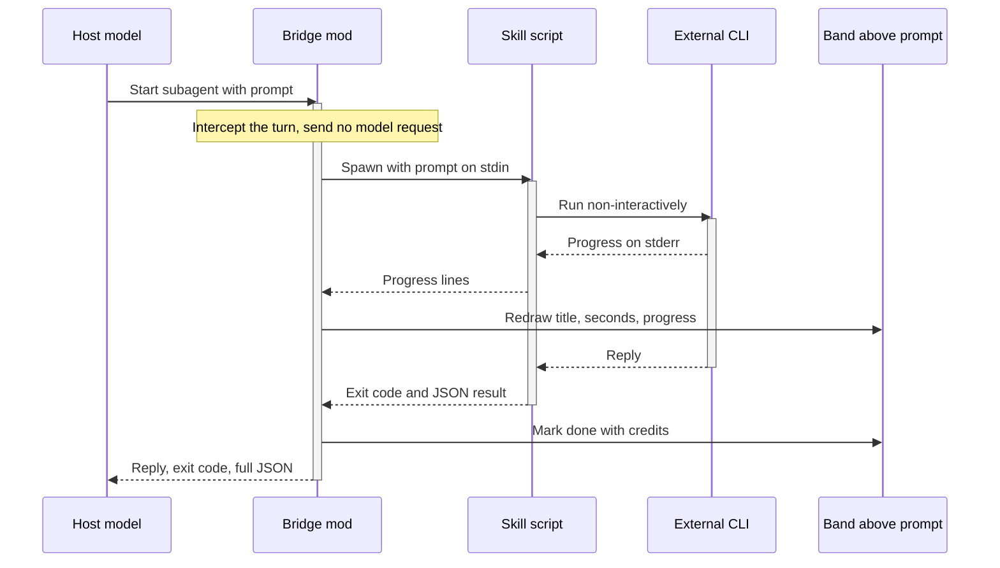

# CLI 橋接 mod：目標與 Codex 研究清單

## Table of Contents

- [概要](#概要)
- [目標](#目標)
- [運作流程](#運作流程)
- [依賴的宿主能力](#依賴的宿主能力)
- [Codex 缺少能力時的替代方向](#codex-缺少能力時的替代方向)
- [已知的坑](#已知的坑)

## 概要

- 本文整理 `fg-kiro-bridge` 的設計，作為把 [misty-marketplace](https://github.com/Aery9527/misty-marketplace) 的 `claude` skill（讓 Codex 呼叫 Claude）改成相同模式的依據。
- `fg-kiro-bridge` 是 Claude Code 的 mod plugin（hooks 模組）：註冊一種 subagent，由 Kiro CLI 回答，而不由宿主模型回答。
- 移植前必須確認 Codex 是否提供 [依賴的宿主能力](#依賴的宿主能力) 中的機制。

[Back to top](#table-of-contents)

---

## 目標

1. 外部 CLI 像原生 subagent：
    - 每次執行在宿主的 task 清單有一列。
    - 該列的標題是任務描述。
2. 不花宿主模型的 token：
    - subagent 的回合由 mod 直接以 CLI 的結果回答，不送模型請求。
    - 實測該回合的 usage 全部是 `0`，也沒有 request ID。
3. 進度可見：
    - 執行中每次執行一行，顯示標題、經過秒數與 CLI 最後一行進度。
    - 結束後該行變暗，顯示狀態與 credits，直到使用者自己送出下一個 prompt 才清除。
    - 多個執行同時進行時各自一行，互不覆蓋。
4. 結果完整交回：
    - 交回 CLI 的答案、腳本的 exit code 與腳本輸出的整份 JSON。
    - 呼叫端依 skill 的規則處理錯誤與用量回報；mod 不自行挑選欄位。
5. 單一呼叫入口：
    - mod 只是轉接層，實際呼叫只走 skill 的腳本，例如 `kiro-run.js`。
    - 模型檢查、credits 與錯誤分類都留在腳本，不在 mod 重寫。
6. 可指定模型與 effort：
    - prompt 第一行是只含 `m`、`e` 的 JSON 物件時，例如 `{"m":"sol","e":"high"}`，轉成腳本的 `--m`、`--e`，其餘內容才交給 CLI。
7. 安全：
    - 不帶寫入權限的選項，例如 Kiro 的 `--write`。
    - 拒絕該 subagent 的所有工具呼叫。
    - mod 沒有接手回合時，備援模型只能回一行固定文字，說明 CLI 沒有被呼叫；嚴禁冒充 CLI 回答。
8. 可中止：
    - 停止 subagent 時，腳本與 CLI 的程序都必須結束，不留下繼續花費額度的程序。

[Back to top](#table-of-contents)

---

## 運作流程

[Back to top](#table-of-contents)

---

## 依賴的宿主能力

- 下表每一列是 `fg-kiro-bridge` 依賴的一項 Claude Code 能力；研究 Codex 時逐列確認對應機制。

| # | 需求 | Claude Code 的做法 | 要在 Codex 確認的事 |
|---|---|---|---|
| 1 | 自訂 agent 類型 | `$.agent.register` 註冊 `<plugin>:<name>`，含名稱與說明 | 外掛能否註冊 subagent 類型，task 清單是否顯示它 |
| 2 | 代答回合 | `turn.step` hook 不呼叫 `next`，自行送出文字與 stop | 有無 hook 能攔下 agent 的回合，不送模型請求就給答案 |
| 3 | 取得 subagent 的 prompt | `turn.start` 的 `e.text`，以 agentId 對應 | hook 能否讀到 subagent 的輸入 |
| 4 | 執行子程序 | `$.process.spawn`：stdin 傳 prompt、分開串流 stdout 與 stderr、讀 exit code、中止時結束子程序 | 外掛能否執行程序並串流輸出，取消時是否結束子程序 |
| 5 | 長時間等待 | 等待宿主 API 不計入 hook 的時間預算；實測 116 秒正常完成 | hook 是否有逾時，上限多少 |
| 6 | 拒絕工具 | `tool.call` hook 回傳 `deny` | 能否依 agent 擋下工具呼叫 |
| 7 | 自訂畫面 | 提示列上方的 band（`ui.render` 的 `AbovePrompt`），以 `$.ui.invalidate` 重畫，`$.clock.every` 每秒更新 | TUI 能否讓外掛畫一列狀態並即時更新 |
| 8 | 分辨 prompt 來源 | `prompt.submit` 的 `e.origin.kind`，區分使用者自己送出（`composer`）與完成通知（`task-notification`） | 事件是否帶有來源欄位 |
| 9 | 發佈 | marketplace 的 catalog 管名稱與版本，`enabledPlugins` 啟用 | 外掛格式與 marketplace 是否支援程式模組 |

- 第 1、2 項是核心；缺少任一項就無法做到「像原生 subagent 且不花宿主 token」。

[Back to top](#table-of-contents)

---

## Codex 缺少能力時的替代方向

- MCP server：
    - 把 CLI 包成一個 MCP 工具，進度以 MCP 的 progress 通知送出。
    - 代價：Codex 的模型要自己決定呼叫該工具並讀結果，仍會花宿主 token。
    - 未查證：Codex 是否顯示 MCP 的 progress 通知。

[Back to top](#table-of-contents)

---

## 已知的坑

- `tools: []` 會被當成全部工具：
    - 必須只留一個工具，例如 `Read`，再由 `tool.call` hook 全部拒絕。
- `$` 只能傳給模組最外層的函式：
    - 傳給內層函式時，validate 會報錯。
- 背景任務的完成通知也會觸發 `prompt.submit`：
    - 它沒有 `isMeta` 標記，只能用 `e.origin.kind` 分辨。
    - 若不分辨，執行結束的那一行會立即被清掉。
- stderr 的一行可能分兩段送到：
    - 必須累積到緩衝，只使用已完整的行。
- 檔案沒有變更時，`/reload-plugins` 不會重新載入 mod：
    - 測試新版前必須先改檔案。
- 畫面狀態放在模組變數：
    - 重新載入時歸零，所以只能放可以遺失的顯示狀態。
- 腳本路徑由 plugin 根目錄往上組出：
    - 嚴禁寫死絕對路徑，因為各電腦的使用者目錄可能不同。

[Back to top](#table-of-contents)
