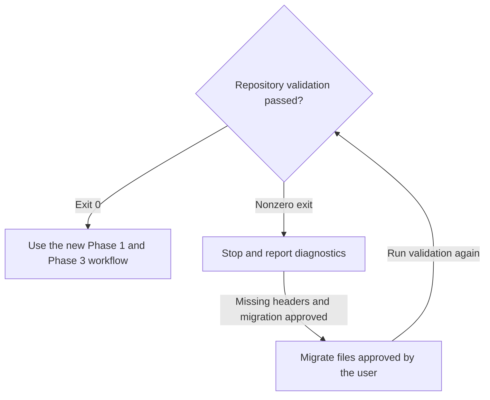

# code-mereology 標頭區塊與 tag 表計畫

- 本計畫描述預計對 skill `code-mereology` 做的變更；所列內容均為待實作，不代表目前的 skill 已提供。
- 做法是讓每份 `bd-*.md` 與 `sd-*.md` 在開頭以結構化方式宣告它的關係與 tag，並提供一支 Node.js 腳本查詢它們。

## 目錄

- [目標](#目標)
- [背景](#背景)
- [已確認的決定](#已確認的決定)
- [區塊格式](#區塊格式)
- [tag 繼承](#tag-繼承)
- [模型上的改變](#模型上的改變)
- [文件鏈的完整性](#文件鏈的完整性)
- [遷移與啟用](#遷移與啟用)
- [腳本 list-relations.mjs](#腳本-list-relationsmjs)
  - [掃描範圍](#掃描範圍)
  - [用法](#用法)
  - [輸出格式](#輸出格式)
  - [輸出範例](#輸出範例)
  - [錯誤處理](#錯誤處理)
- [agent 的使用時機](#agent-的使用時機)
- [不在範圍](#不在範圍)
- [執行步驟](#執行步驟)
- [驗證](#驗證)

## 目標

- agent 可以透過腳本用更少但精準的資訊來連結到所有與手上任務有關聯的文件。
- 驗收條件：
    - 從一份文件出發時，`-a` 一次查詢就能取得指定範圍內的文件路徑、關係型別與說明。
    - 從一個 tag 出發時，`-t` 列出候選文件。需要確認關係時，再用 `-a` 查詢該文件。
    - 腳本輸出每一條關係的說明，agent 據此判斷要不要讀取對方的文件。
    - agent 不必為了找出關聯而讀取無關文件的內容。
    - agent 能自行決定要追查的深度與廣度，腳本只輸出該範圍內的資料。

[回到目錄](#目錄)

---

## 背景

- 現行 skill 的結構邊散在內文連結中。組成、依賴、指回上層的導航三種連結只能靠語意判讀，腳本無法分辨。
- agent 因此要逐份讀文件，才能判斷哪些文件是某份文件的上層、哪些是依賴者；Phase 3 的反向回溯就是這樣進行的。
- 現行 skill 沒有依主題找文件的方法。
- 連到尚未存在的文件時，現行規則靠連結後的 `(planned)` 標記與 `list-planned.mjs` 追蹤。
- partial leaf 已有一行寫在標題正下方的 `code-mereology-partial` 標記。
- skill 隨附的腳本只用 Node.js 標準函式庫。

[回到目錄](#目錄)

---

## 已確認的決定

- 區塊放在 H1 下方，寫成 Markdown 清單，不用 YAML frontmatter。
    - 原因：關係仍是可點擊的 Markdown link，`(planned)` 標記與 `list-planned.mjs` 不必修改；Node.js 標準函式庫也沒有 YAML 解析器。
- 關係分成組成（`parts`）與依賴（`depends`）兩種。
    - 原因：邊的型別是腳本無法從內文推得的資訊；分開後腳本可直接算出每份文件的上層與依賴者。
- `parts` 與 `depends` 的每個項目獨立一行，格式為「連結: 說明」，說明寫明為什麼連到它。
    - 原因：腳本把說明連同關係一起輸出，agent 不必開啟來源文件，就能判斷要不要讀取對方的文件。
    - 區塊的 `parts` 取代現行內文中的下一層節點清單，同一份清單只寫在一處。
- 指向 `bd-*.md` 或 `sd-*.md` 的 Markdown link 只能出現在區塊中；內文提到這些文件時不寫連結，改寫成斜體的 label，即 `*label*`。
    - 原因：所有關係集中在區塊，腳本取得的資料就是全部；內文不重複連結路徑，節省字數。
    - 斜體讓讀者分辨出這段文字指的是區塊中的那個 label。
    - 內文的斜體只能用來寫 label，粗體留給一般的強調；腳本因此能驗證每個斜體文字都是區塊中的 label。
- `bd-*.md` 的 `depends` 可以有值，連到與它有關聯的其他 `bd-*.md`。
    - 原因：主題之間的關聯，例如一個業務系統需要另一個業務系統交付的結果，現行規則沒有地方可以寫。
    - `depends` 的兩端必須同層。腳本驗證文件種類，Phase 1 核對角色與實際 scope。
- 專案共用 repository 根目錄下的 `docs/code-mereology.json`，monorepo 也只有這一份。`tags` 保存總 tag 表，例如 `{"tags": {"search": "查詢功能"}}`。選用的 `exclude` 定義[掃描範圍](#掃描範圍)。
    - 設定檔只接受已定義的 `tags` 與 `exclude` 鍵。日後新增鍵時，專案須同步更新會讀取該設定的 skill 版本。
    - tag 名稱只能由小寫英文字母與數字組成，中間最多用兩個 `-` 串接，也就是最多三段；規則為 `^[a-z0-9]+(-[a-z0-9]+){0,2}$`。
        - 合格：`backend`、`oauth2`、`data-access`、`user-data-access`。
        - 不合格：`Backend`、`data_access`、`a-b-c-d`、`-backend`、`data--access`、`資料存取`。
    - 總 tag 表與掃描範圍內文件的 `tags` 必須雙向一致。文件使用的 tag 必須在表中，表中的每個 tag 必須由至少一份掃描範圍內的文件宣告。腳本驗證此規則。
- tag 具有繼承性：下層文件具有上層文件的 tag，且嚴禁重複宣告；由腳本驗證。
    - 繼承沿每一條 `parts` 邊往下傳，不沿 `depends` 邊。
    - 一份文件有多個上層時，繼承的 tag 取聯集。
- 腳本的查詢提供選項，讓 agent 自行選擇追查的深度與廣度。
- 腳本檢查文件鏈是否斷裂，找出沒有被鏈連到的文件；定義見[文件鏈的完整性](#文件鏈的完整性)。
    - `depends` 的循環不檢查。現行規則允許使用者明確決定保留依賴循環，腳本不能把它當成錯誤。

[回到目錄](#目錄)

---

## 區塊格式

```markdown
# 資料列讀寫

- `parts`:
- `depends`:
    - [資料表結構](../schema/sd-table-schema.md): 寫入前依結構驗證每一列的欄位
    - [列快取](../cache/sd-row-cache.md) (planned): 讀取時先查快取
- `tags`:

## Table of Contents
```

- H1 必須用 `# `。H1 之前只允許空行和選用的 frontmatter，腳本略過 frontmatter 內容。
- 從 H1 到第一個 `## ` 標題或檔尾之間，只允許空行、選用的 partial 標記與三鍵清單。partial leaf 的 `code-mereology-partial` 標記必須緊接 H1，區塊接在標記之後。介紹文字或其他正文移到二級標題下。
- 三個鍵 `parts`、`depends`、`tags` 都必須出現且各一次，順序固定。
    - 沒有值時，`parts` 與 `depends` 不帶子項目，`tags` 的冒號後留空。
    - 原因：腳本才能分辨「沒有」與「漏寫」。
- `parts` 與 `depends` 的項目：
    - 每個項目是鍵下方一行縮排的清單項目，格式為 `- <連結>: <說明>`；鍵的那一行冒號後不寫內容。
    - 目標尚未存在時，在連結後標 `(planned)`，格式為 `- <連結> (planned): <說明>`。
    - 連結是 inline link，形式與現行 planned link 的規定相同：單行、無 title、label 無方括號、目的地無空白或括號。一個項目只有一個連結。
    - 目標必須是相對於來源文件的純檔案路徑，解析後須在[掃描範圍](#掃描範圍)內。路徑使用正斜線，既有目標的大小寫須與實際路徑一致。嚴禁使用絕對路徑、網址、查詢字串或 `#fragment`。
    - 同一份文件的區塊中，每個連結的 label 不得重複；內文的 `*label*` 才能對回唯一的一個項目。
    - 邊以來源文件、關係型別和正規化後的目標文件識別。同一條邊只能宣告一次，更換 label 或改用等價路徑也算重複。
    - 說明必填，只寫一行，寫明為什麼連到它：`parts` 寫該文件在這個組成中扮演的角色，`depends` 寫需要對方提供的能力。
    - 只列 `bd-*.md` 與 `sd-*.md`；不列程式碼、`-plan`、`-perf`，也不列指回上層的導航連結。
- `tags` 的項目：
    - 值是 inline code，寫在鍵的同一行，項目之間固定以半形 `,` 分隔，例如 `` `backend`, `persistence` ``。
    - 每個都必須是 `docs/code-mereology.json` 中 `tags` 的鍵，大小寫須相同。
    - 只寫這份文件自己宣告的 tag，嚴禁寫入已繼承的 tag；見 [tag 繼承](#tag-繼承)。
- `sd-*.md` 的區塊計入 300 行上限。`bd-*.md` 沿用現行規則，沒有行數上限。

各角色填寫的內容：

| 文件 | `parts` | `depends` |
|---|---|---|
| `bd-*.md` | 下一層文件 | 與這個主題有關聯的其他 `bd-*.md` |
| overview 角色的 `sd-*.md` | 子層 `sd-*.md` | 留空 |
| leaf 角色的 `sd-*.md` | 留空 | 它依賴的 leaf |
| partial leaf | 留空 | 留空；現行規則禁止它畫依賴邊 |

- `bd-*.md` 的 `depends` 表示這個主題要成立，需要另一個主題交付的結果。
    - root 層的主題可以互相依賴。同為 submodule 層的主題可以跨 submodule 依賴。root 主題和 submodule 主題屬於不同抽象層，兩端嚴禁以 `depends` 相連。
    - 正例為 `checkout/docs/bd-checkout.md` 依賴 `inventory/docs/bd-stock.md` 提供可售數量。反例為 `docs/bd-orders.md` 以 `depends` 指向 `checkout/docs/bd-checkout.md`。若 checkout 參與 root 主題的組成，應由 root 主題的 `parts` 指向 checkout。
    - 主題依賴可以來自程式碼、檔案交換或人工流程。
- `sd-*.md` 的 `depends` 由需要能力的 leaf 指向提供能力的 leaf，可以跨 submodule。partial leaf 可以提供能力，自己的 `depends` 必須留空。
- 腳本驗證 `depends` 兩端的文件種類是否相同。已有 `parts` 項目的 `sd` 嚴禁宣告 `depends`，也嚴禁成為 `depends` 的目標。Phase 1 必須核對 `bd` 的實際抽象層級，以及依文件責任確認 `sd` 的角色。

[回到目錄](#目錄)

---

## tag 繼承

### 規則

- tag 沿組成邊由上往下繼承：一份文件的 `parts` 連到哪些文件，那些文件就繼承它的 tag。
- 繼承會一路往下傳：root `bd-*.md` → submodule `bd-*.md` → overview `sd-*.md` → 子層 `sd-*.md`。
- tag 不沿依賴邊繼承。`depends` 表示需要對方的能力，不表示屬於對方的主題。
- 一份文件的有效 tag 是「自己宣告的 tag」加上「所有上層的有效 tag」。
- 一份文件可以有多個上層：現行規則允許多份 `bd-*.md` 以 `parts` 連到同一份 `sd-*.md`，因為一個模組可以參與多個主題。有多個上層時，繼承的 tag 取聯集。
    - 例：`sd-table-rows.md` 同時被宣告 `backend` 的架構主題與宣告 `orders` 的業務主題連到時，它的有效 tag 包含 `backend` 與 `orders`，兩者都不得在它自己的 `tags` 重複宣告。
- 文件嚴禁宣告它已經繼承的 tag。
    - 原因：同一個事實只寫在一處。重複宣告的 tag 在上層改掉後仍會留在下層，查詢結果就不再可信。
- tag 必須宣告在它適用範圍的最上層文件。某個 tag 適用於一份文件的所有下層時，只在該文件宣告一次。
- 帶 `(planned)` 的 `parts` 連結，其目標尚未存在，不產生繼承。
- 上層文件後來補上某個 tag 時，下層原有的同名宣告即成為違規，必須在同一次變更中刪除。

### 範例

| 文件 | 上層 | `tags` 的寫法 | 有效 tag |
|---|---|---|---|
| `docs/bd-backend-layers.md` | 無 | `backend` | `backend` |
| `service/table/sd-table.md` | `bd-backend-layers.md` | `persistence` | `backend`、`persistence` |
| `service/table/rows/sd-table-rows.md` | `sd-table.md` | 留空 | `backend`、`persistence` |
| `service/query/sd-query.md` | `bd-backend-layers.md` | `search` | `backend`、`search` |

- `sd-table-rows.md` 若寫 `persistence`，違規：它已從 `sd-table.md` 繼承。
- `sd-table-rows.md` 若寫 `backend`，違規：它已經由 `sd-table.md` 從 `bd-backend-layers.md` 繼承。
- `sd-query.md` 以 `depends` 連到 `sd-table-schema.md`，不因此取得 `persistence`。

### tag 繼承的驗證

- `list-relations.mjs` 在所有查詢模式都驗證[掃描範圍](#掃描範圍)內的文件。可確定某個 tag 已由上層繼承時，回報重複宣告並指出宣告該 tag 的上層。受組成環影響的文件依[錯誤處理](#錯誤處理)處理。

[回到目錄](#目錄)

---

## 模型上的改變

- 腳本的文件關係圖只收錄標頭區塊的 `parts` 與 `depends`。leaf 到程式碼的介面連結留在正文，仍依現行規則用 `list-planned.mjs` 追蹤未完成的目標。
- 指向 `bd-*.md` 或 `sd-*.md` 的 Markdown link 只能出現在區塊中，內文嚴禁出現。
    - 內文需要提到的每一份 `bd-*.md` 或 `sd-*.md`，都必須已列在這份文件的 `parts` 或 `depends`。
    - 內文提到它時不寫連結，用區塊中該連結的 label 稱呼它，並以斜體包起來，即 `*label*`，字面與區塊的 label 完全相同。
        - 例如區塊的 label 是「資料表結構」，正文寫「寫入前依 *資料表結構* 驗證欄位」。
    - 內文的斜體只能用來寫 label；一般的強調用粗體 `**…**`。
        - 斜體只能用 `*` 寫，嚴禁用 `_`，也嚴禁與粗體疊用成 `***…***`。
        - 腳本檢查區塊之後、程式碼區塊與 inline code 之外的每一個 `*…*`：它的文字必須與區塊中某個連結的 label 完全相同。
    - 原因：同一條關係只寫在區塊一處；內文省下重複的連結路徑。
    - 查找上層文件時，使用 `-a <文件> -f p`。
    - 正文可以連到程式碼、`-plan`、`-perf`、同一份文件內的標題及外部網址。本 repo 設計文件之間的連結，即使帶有 `#fragment` 或使用 reference-style 語法，仍受本規則約束。
- 區塊的 `parts` 取代現行內文中的清單，內文不再重複列出：
    - `bd-*.md` 現行的「下一層節點清單，每個節點附一句話說明它在這裡扮演的角色」。
    - overview 現行的「子層文件清單，每份附一句話」。
- 區塊的 `depends` 取代 leaf 現行在內文中連到被依賴 leaf 的連結；關係圖仍必須畫出這條依賴。
- `depends` 的兩種合法配對見[區塊格式](#區塊格式)。

[回到目錄](#目錄)

---

## 文件鏈的完整性

- 文件鏈的檢查涵蓋[掃描範圍](#掃描範圍)內的所有文件。

| 斷裂方式 | 判定條件 |
|---|---|
| 邊斷了 | 連結沒有 `(planned)`，但目標不存在 |
| 組成成環 | `parts` 的連結形成循環 |
| 文件沒被連到 | 依下表，隨文件種類而不同 |

「文件沒被連到」的判定：

| 文件 | 判定為斷裂的條件 | 原因 |
|---|---|---|
| 一般的 `sd-*.md` | 從任何一份 `bd-*.md` 沿 `parts` 都走不到它 | 每個模組必須屬於至少一個主題 |
| partial leaf | 沒有任何其他文件以 `parts` 或 `depends` 連到它 | partial leaf 進場時可以只被依賴，避免為既有程式碼補寫整套組裝 |
| `bd-*.md` | 不檢查 | 它是鏈的起點；submodule 的 `bd-*.md` 只在主題跨 submodule 時才被 root 連到 |

- 走訪只沿目標已存在的邊；帶 `(planned)` 的邊不算連到。
- 腳本以標題與第一個 `## ` 標題之間、開頭為 `` > `code-mereology-partial`: `` 的行認出 partial leaf。
- `-plan` 與 `-perf` 檔刻意不在圖裡，不列入檢查。
- partial leaf 補完並移除標記，或拆分並升格為 overview 時，必須在同一次 Phase 1 讓轉換後的文件可從適當的 `bd` 沿 `parts` 到達。
    - 若已有適當主題，就接到它的 `parts`。若沒有，必須在所屬 scope 建立只涵蓋本次轉換的新主題，並在同一次 Phase 1 交由使用者確認。
    - 升格時，依[切分規則](#階段-2規則文件)把原有依賴移到相應的子 leaf。

- 下列每個案例都獨立修改[輸出範例](#輸出範例)的檔案。

| 改動 | 結果 |
|---|---|
| 從 `sd-table.md` 的 `parts` 移除 `sd-table-rows.md` | `sd-table-rows.md` 斷裂：沒有任何 `bd-*.md` 走得到它 |
| 同上，但 `sd-query.md` 以 `depends` 連到 `sd-table-rows.md` | 仍然斷裂：`depends` 不算歸屬於主題 |
| 移除 `sd-table.md` 指向 rows 的 `parts`，新增 `sd-query.md` 指向 rows 的 `depends`，再把 rows 改為 partial leaf 並清空它自己的 `depends` | rows 由 query 依賴，文件鏈有效 |
| 刪除 `bd-backend-layers.md` | 回報四份 `sd-*.md` 無法從主題到達，另回報 `backend` 無人宣告 |

- 另以無 `bd` 的 legacy scope 驗收轉換。該 scope 內的 `sd-stock.md` 是 partial leaf，另一個 scope 內已接回主題的普通 leaf `sd-checkout.md` 依賴它。

| 改動 | 結果 |
|---|---|
| 移除 `sd-stock.md` 的 partial 標記，並在同一次 Phase 1 確認新增的 `bd-stock.md`，以 `parts` 連到 `sd-stock.md` | 保留 checkout 對 stock 的原依賴，檢查通過。只移除標記時回報 stock 無法從主題到達 |
| 將 `sd-stock.md` 升格為 overview，以 `parts` 連到提供可售數量的 `sd-availability.md`，將 checkout 的 `depends` 改指向 availability，再接到同次 Phase 1 確認的 `bd-stock.md` | overview 與子 leaf 都可從主題到達，檢查通過。少了主題到 overview 的 `parts` 時，至少回報 overview 無法從主題到達 |

[回到目錄](#目錄)

---

## 遷移與啟用



- 既有專案必須以實際 repository root 執行一次無查詢選項的全庫檢查。取得 exit code `0` 後，才可採用新版 Phase 1 與 Phase 3。
- 若有文件缺少標頭區塊，停止並列出缺少區塊的文件，交由使用者決定是否遷移。遷移時將實際的組成與依賴移到區塊，移除舊導航連結，保留程式碼連結，再重跑檢查。採用後若錯誤出在任務範圍外的文件，停止並回報該錯誤。
- Phase 1、Phase 3 與階段之外的影響查詢都必須以 exit code `0` 的輸出判斷影響範圍。非零時，stdout 只供診斷。未遷移的文件可能隱藏指向起點的邊，空輸出無法證明起點沒有上層或依賴者。
    - 錯誤出自本次編輯時，必須先將變更修正，再重跑檢查。若 Phase 1 修正了關係，仍須依既有 gate 交由使用者確認。
    - 任務開始前已存在且在任務範圍內的圖錯誤，Phase 1 依本次任務修正後重跑。Phase 3 停止並退回 Phase 1。階段之外的修改停止並回報使用者。
    - Phase 3 依程式碼更正 partial leaf 的既有契約記載時，仍適用現行例外。本次更正造成的區塊或斜體格式錯誤在原階段修正。
- 本 repo 的遷移依序執行下列步驟。
    1. 先讀 [UPSTREAM-PARITY.md](../claude/UPSTREAM-PARITY.md)，再改 [bridge runtime](../../skills/claude/codex-plugin/docs/bd-bridge-runtime.md)、[broker session lifecycle](../../skills/claude/codex-plugin/sd-broker-session-lifecycle.md) 與 [session transfer](../../skills/claude/codex-plugin/sd-session-transfer.md) 三份原始文件。bridge runtime 內的 [stop review hook](../../skills/claude/codex-plugin/scripts/stop-review-gate-hook.mjs) 連結留在正文。同一次變更更新 UPSTREAM-PARITY 的封裝說明。
    2. 在根目錄下建立 `docs/code-mereology.json`，設定 `"exclude": ["codex-plugins"]`，並依遷移後文件實際宣告的 tag 填寫 `tags`。
    3. 執行 [Codex 封裝同步](../../scripts/sync-codex-plugins.ps1)。從 repository root 執行 `node skills/code-mereology/scripts/list-relations.mjs .`，必須回傳 `0`、stderr 留空，stdout 嚴禁出現以 `codex-plugins/` 開頭的列。

[回到目錄](#目錄)

---

## 腳本 list-relations.mjs

### 掃描範圍

- 從指定 root 搜尋 `bd-*.md` 與 `sd-*.md`，沿用現有搜尋器對版本控制目錄、`.worktree` 與目錄連結的排除行為。`-plan`、`-perf` 的檔案不進入文件關係圖。
- 選用的 `exclude` 是從 root 起算的實體目錄路徑清單，例如 `{"exclude": ["codex-plugins"]}`。腳本略過列出的目錄及其子樹，即使 Git 已追蹤其中的檔案。省略 `exclude` 等同空清單。
- 每一路徑須以正斜線表示，大小寫須與磁碟一致，且須指向 root 內已存在的子目錄。嚴禁使用絕對路徑、`..`、root 本身或會經過目錄連結的路徑。
- 區塊連結指向排除子樹或 root 外的路徑時一律報錯，包括帶有 `(planned)` 的連結。`list-plans.mjs` 不套用這份 `exclude`。

### 用法

```text
node <skill-root>/scripts/list-relations.mjs [-a <文件> [-f <關係>] [-d <深度>]] [-t <tag>] [<repository-root>]
```

- 省略 `<repository-root>` 時使用目前目錄。Phase 1、Phase 3 與階段之外的影響查詢都必須明確傳入實際 repository root。從子目錄執行時，該子目錄不能代替 repository root。
- 沒有 `-a` 也沒有 `-t` 時，輸出整個掃描範圍的資料。
- `-a` 與 `-t` 不可同時使用。
- 選項與選項的值只有縮寫一種寫法，沒有較長的別名。
    - 原因：agent 每次呼叫都要輸出這些字，縮寫節省輸出的 token；只有一種寫法，規則文件與測試也不必涵蓋兩套。

| 選項 | 意義 | 預設 |
|---|---|---|
| `-a <文件>` | about，追查起點。相對於目前目錄，必須是掃描範圍內已存在的 `bd-*.md` 或 `sd-*.md`，大小寫須符合實際路徑 | 無 |
| `-f <關係>` | follow，廣度：要追查哪幾種關係，把代表各關係的字母連寫，不加分隔符號，例如 `pu` | `pcdu`，即四種全部 |
| `-d <深度>` | depth，深度：從起點最多走幾條邊，正整數或代表不限深度的 `a` | `1` |
| `-t <tag>` | tag，列出有效 tag 包含它的所有文件 | 無 |

`-f` 可用的關係：

| 字母 | 追查的對象 |
|---|---|
| `p` | parents，上層：`parts` 連到該文件的文件 |
| `c` | children，下層：該文件的 `parts` 連到的文件 |
| `d` | dependencies，它依賴的文件：該文件的 `depends` 連到的文件 |
| `u` | used by，依賴它的文件：`depends` 連到該文件的文件 |

- 按 `-f` 選出的方向計算從起點到每份文件的最短距離。每份文件只在最短距離展開一次。深度為 `n` 時，距離小於 `n` 的文件才展開。不限深度時，依賴環也會走訪完畢。
- 每條走過的邊只輸出一次。輸出保留原始宣告方向，即使查詢是往上層或依賴者反向走訪。
- 帶 `(planned)` 的邊會輸出，但不從它尚未存在的目標繼續追查。

### 輸出格式

- 每列一筆資料，欄位以 tab 分隔。前三欄固定是 `<文件>`、`<種類>`、`<值>`；其後的欄位隨種類而不同，`<註記>` 是選用的最後一欄。

| 種類 | 欄位 | 值 | 說明 | 註記 |
|---|---|---|---|---|
| `parts`、`depends` | `<文件>`、`<種類>`、`<值>`、`<說明>`、選用的 `<註記>` | 目標文件的路徑 | 區塊中該項目的說明，原樣輸出 | 目標尚未存在時為 `planned` |
| `tag` | `<文件>`、`<種類>`、`<值>`、選用的 `<註記>` | tag 名稱 | 無此欄 | 該 tag 是繼承來的時為 `inherited` |

- 說明屬於宣告該關係的文件，也就是第一欄的文件。追查上層或依賴者時，說明寫的是對方為什麼連到起點文件。
- 路徑相對於 repository root，使用正斜線。
- 文件依路徑不分大小寫排序。同一份文件內的順序：`parts`、`depends`、宣告的 tag，三者依區塊順序；之後是繼承的 tag，依名稱排序。
- 各模式輸出的範圍：

| 模式 | 邊 | tag |
|---|---|---|
| 無查詢選項 | 全部 | 每份文件宣告的 tag；不含繼承的 |
| `-a` | 追查時走過的每一條邊，各輸出一次 | 只有起點文件的有效 tag |
| `-t` | 不輸出 | 有效 tag 包含它的每份文件，各一列 |

### 輸出範例

- 從含下列六個檔案的暫存 repository root 執行四組查詢，各組命令都可在參數末尾加上 `.` 指定此 root。檔名標記是說明，檔案內容從其下一行開始，使用 UTF-8。

```text
=== docs/code-mereology.json ===
{"tags": {"backend": "後端服務層", "persistence": "資料存取", "search": "查詢功能"}}
=== docs/bd-backend-layers.md ===
# 後端服務層

- `parts`:
    - [資料表](../service/table/sd-table.md): 保存資料列與資料表結構
    - [查詢](../service/query/sd-query.md): 依條件查出資料列
- `depends`:
- `tags`: `backend`
=== service/table/sd-table.md ===
# 資料表

- `parts`:
    - [資料列讀寫](rows/sd-table-rows.md): 讀寫資料列
    - [資料表結構](schema/sd-table-schema.md): 定義欄位與型別
- `depends`:
- `tags`: `persistence`
=== service/table/rows/sd-table-rows.md ===
# 資料列讀寫

- `parts`:
- `depends`:
    - [資料表結構](../schema/sd-table-schema.md): 寫入前依結構驗證每一列的欄位
    - [列快取](../cache/sd-row-cache.md) (planned): 讀取時先查快取
- `tags`:
=== service/table/schema/sd-table-schema.md ===
# 資料表結構

- `parts`:
- `depends`:
- `tags`:
=== service/query/sd-query.md ===
# 查詢

- `parts`:
- `depends`:
    - [資料表結構](../table/schema/sd-table-schema.md): 依結構解析查詢條件中的欄位
- `tags`: `search`
```

無查詢選項：

```text
docs/bd-backend-layers.md	parts	service/table/sd-table.md	保存資料列與資料表結構
docs/bd-backend-layers.md	parts	service/query/sd-query.md	依條件查出資料列
docs/bd-backend-layers.md	tag	backend
service/query/sd-query.md	depends	service/table/schema/sd-table-schema.md	依結構解析查詢條件中的欄位
service/query/sd-query.md	tag	search
service/table/rows/sd-table-rows.md	depends	service/table/schema/sd-table-schema.md	寫入前依結構驗證每一列的欄位
service/table/rows/sd-table-rows.md	depends	service/table/cache/sd-row-cache.md	讀取時先查快取	planned
service/table/sd-table.md	parts	service/table/rows/sd-table-rows.md	讀寫資料列
service/table/sd-table.md	parts	service/table/schema/sd-table-schema.md	定義欄位與型別
service/table/sd-table.md	tag	persistence
```

`-a service/table/schema/sd-table-schema.md`，即直接相連的所有文件：

```text
service/query/sd-query.md	depends	service/table/schema/sd-table-schema.md	依結構解析查詢條件中的欄位
service/table/rows/sd-table-rows.md	depends	service/table/schema/sd-table-schema.md	寫入前依結構驗證每一列的欄位
service/table/schema/sd-table-schema.md	tag	backend	inherited
service/table/schema/sd-table-schema.md	tag	persistence	inherited
service/table/sd-table.md	parts	service/table/schema/sd-table-schema.md	定義欄位與型別
```

`-a service/table/schema/sd-table-schema.md -f p -d a`，即所有上層：

```text
docs/bd-backend-layers.md	parts	service/table/sd-table.md	保存資料列與資料表結構
service/table/schema/sd-table-schema.md	tag	backend	inherited
service/table/schema/sd-table-schema.md	tag	persistence	inherited
service/table/sd-table.md	parts	service/table/schema/sd-table-schema.md	定義欄位與型別
```

`-t persistence`：

```text
service/table/rows/sd-table-rows.md	tag	persistence	inherited
service/table/schema/sd-table-schema.md	tag	persistence	inherited
service/table/sd-table.md	tag	persistence
```

### 錯誤處理

- 腳本按下列順序判定。所有錯誤都寫到 stderr。文件與設定檔使用 `ERROR <路徑>[:<行號>]: <訊息>`。

1. 參數語法錯誤，或 root 不存在、不是目錄時，回傳 `2`，不掃描也不輸出資料。已提供的 `-a` 與 `-t` 值留到第 3 步驗證。
2. 驗證設定檔是否可讀，並檢查 UTF-8、JSON 語法、欄位與欄位值。任一項無效便回傳 `1`，不掃描也不輸出資料。設定檔不存在時，視為空設定。
3. 按參數錯誤表驗證 `-a` 路徑的所有條件，以及 `-t` 的 tag 名稱與登錄狀態。任一項無效便回傳 `2`，不輸出資料。
4. 檢查全庫掃描範圍內的文件及 tag 宣告情況。若有錯誤，回傳 `1`，依下列規則輸出仍可確定的資料。全部通過時回傳 `0`。

- 語法無效、重複或目標無效的邊不輸出。若 `-a` 指定的檔案存在，但無法讀取或無法解析其標頭區塊，回報文件錯誤，stdout 留空。
- 受 `parts` 環影響的範圍包含環中的文件，以及沿該環的 `parts` 可到達的後代。回報該環，省略受影響文件的繼承 tag 和重複繼承宣告檢查。其餘有效的邊、合法宣告的 tag 與可確定的繼承 tag 仍可按查詢輸出。總 tag 表的使用狀態依實際可讀到的宣告檢查。
- `parts` 環的診斷以該環內排序最前的文件起算，定位到該文件的 `parts` 鍵所在行。訊息列出路徑，最後回到起點。排序沿用[輸出格式](#輸出格式)的路徑排序。

文件的錯誤：

| 情況 | 結果 |
|---|---|
| 文件缺少標頭區塊、缺少某個鍵、鍵重複或鍵順序錯誤 | 錯誤 |
| H1 或 H1 到第一個二級標題之間的格式不合規，例如清單前有導言 | 錯誤 |
| `parts` 或 `depends` 的項目不符合 `- <連結>: <說明>`，例如 reference-style link、一個項目有多個連結、鍵的那一行冒號後有內容 | 錯誤 |
| `parts` 或 `depends` 的項目沒有說明，或說明含有 tab 字元 | 錯誤 |
| `tags` 的值含有 inline code 與分隔用的 `,` 以外的內容，例如以 `、` 分隔 | 錯誤 |
| 連結沒有 `(planned)`，但目標不存在 | 錯誤 |
| 連結有 `(planned)`，但目標已存在 | 錯誤 |
| 目標不是掃描範圍內的 `bd-*.md` 或 `sd-*.md`，例如在 root 外、排除子樹、被略過的目錄，或是 `-plan`、`-perf` 檔 | 錯誤 |
| 區塊連結路徑不合規，例如帶 `#fragment`、為絕對路徑，或大小寫與既有目標不同 | 錯誤 |
| 同一份文件的區塊中有兩個連結的 label 相同 | 錯誤 |
| 同一來源與關係型別重複宣告同一目標，即使 label 或路徑寫法不同 | 錯誤 |
| 內文的 `*…*` 不是區塊中任何連結的 label，或內文有 `***…***` | 錯誤 |
| 正文有指向另一份本 repo `bd-*.md` 或 `sd-*.md` 的 inline link，含指向該檔案的 `#fragment` 連結。`-plan`、`-perf` 檔不在此限 | 錯誤 |
| `depends` 的兩端文件種類不同，例如 `bd-*.md` 連到 `sd-*.md` | 錯誤 |
| 有 `parts` 項目的 `sd` 宣告 `depends` | 錯誤 |
| `depends` 指向已有 `parts` 項目的 `sd` | 錯誤 |
| tag 不在 `docs/code-mereology.json` 的 `tags` 中；該檔不存在或沒有 `tags` 鍵時，視為沒有任何 tag | 錯誤 |
| 文件宣告了它已繼承的 tag | 錯誤；訊息指出 tag 名稱與宣告它的上層文件 |
| `parts` 的連結形成循環 | 錯誤；繼承在循環上沒有定義 |
| 一般的 `sd-*.md` 無法從任何 `bd-*.md` 沿 `parts` 走到 | 錯誤 |
| partial leaf 沒有被任何其他文件以 `parts` 或 `depends` 連到 | 錯誤 |
| `depends` 的連結形成循環 | 不算錯誤，不檢查 |
| `docs/code-mereology.json` 不是 JSON 物件，或有 `tags`、`exclude` 以外的頂層鍵 | 第 2 步的設定檔錯誤 |
| `docs/code-mereology.json` 的 `tags` 不是「字串對字串」的 JSON 物件 | 第 2 步的設定檔錯誤 |
| `docs/code-mereology.json` 的 tag 名稱不符合命名規則，例如 `Backend` 或 `a-b-c-d` | 第 2 步的設定檔錯誤 |
| `exclude` 不是路徑字串清單，或某個路徑不符合[掃描範圍](#掃描範圍)的條件 | 第 2 步的設定檔錯誤 |
| `docs/code-mereology.json` 的 tag 沒有被任何文件在 `tags` 宣告 | 第 4 步的錯誤。繼承而來的不算宣告 |
| 檔案不是 UTF-8 | 錯誤，其他檔案照常處理 |

- 例：`sd-table-rows.md` 的 `tags` 寫了 `backend` 時，stderr 為
  `ERROR service/table/rows/sd-table-rows.md:7: tag "backend" is inherited from docs/bd-backend-layers.md`。
- 例：`sd-query.md` 的 `tags` 改為留空後，沒有文件宣告 `search`，stderr 為
  `ERROR docs/code-mereology.json: tag "search" is not declared by any document`。

參數的錯誤：

| 情況 | 結果 |
|---|---|
| 未知的選項，或選項缺少值 | 錯誤 |
| `-a` 與 `-t` 同時使用 | 錯誤 |
| `-f` 或 `-d` 沒有搭配 `-a` | 錯誤 |
| `-f` 的值含有 `p`、`c`、`d`、`u` 以外的字元，或同一個字母出現兩次 | 錯誤 |
| `-d` 不是正整數也不是 `a` | 錯誤 |
| 使用較長的選項名稱，例如 `--about` | 錯誤；屬於未知的選項 |
| `-a` 的路徑不在掃描範圍內、不存在、大小寫不符、不是檔案、不是 `bd-*.md` 或 `sd-*.md`，或是 `-plan`、`-perf` 檔 | 錯誤 |
| `-t` 的值不符合 tag 命名規則，或未在設定的 `tags` 登錄 | 錯誤 |

[回到目錄](#目錄)

---

## agent 的使用時機

- 規則文件必須寫明下列時機與對應的查詢。表內只列查詢選項，每次呼叫仍須在參數末尾明確傳入實際 repository root。

| 時機 | 查詢 | 取得 |
|---|---|---|
| 階段之外修改既有程式碼前，已找到程式碼旁的 `sd-*.md` | `-a <該文件> -f pu` | 指向它、修改後必須對照的文件 |
| Phase 1 修改既有設計文件前 | `-a <該文件>` | 直接相連的文件，用來判斷變更的影響 |
| Phase 1 需要找出與某個主題有關的文件 | 先讀設定檔的 `tags` 選出 tag，再用 `-t <tag>` | 有效 tag 包含它的候選文件。需要關係時，再查 `-a <文件>` |
| Phase 3 冷載入，找出 leaf 的上層與依賴者 | `-a <leaf> -f pu` | `parts` 指向它的是上層，`depends` 指向它的是依賴者 |
| Phase 3 檢查後，某份上層或依賴者改變了它對外描述的關係 | 對那份文件再執行同一個查詢 | 下一層要檢查的文件 |

- 其他情況由 agent 依任務自行選擇 `-f` 與 `-d`。
- agent 依每一條關係的說明，決定要讀取哪些文件；與手上任務無關的文件不讀。
- Phase 3 維護已檢查的文件集合，每份父層或依賴者只處理一次。只有當文件對外描述的關係改變，才從該文件繼續查詢。

[回到目錄](#目錄)

---

## 不在範圍

- 腳本不檢查內文是否以斜體以外的寫法，例如不加任何標記的文字，提到沒列在區塊的文件。這種提及無法以程式辨識，只能由撰寫文件的 agent 遵守。
    - 腳本能檢查的是連結與斜體：內文出現指向 `bd-*.md` 或 `sd-*.md` 的 inline link，或斜體文字不是區塊中的 label，即為錯誤；見[錯誤處理](#錯誤處理)。
- reference-style 的設計文件連結仍禁止出現在正文，由 Phase 1 人工檢查。
- Phase 1 人工依文件責任核對角色，以及 `bd` 依賴兩端是否位於同一抽象層。腳本只驗證[錯誤表](#錯誤處理)列出的區塊條件。
- 既有專案的文件遷移由各專案另行決定，依[遷移與啟用](#遷移與啟用)驗收。

[回到目錄](#目錄)

---

## 執行步驟

1. **計畫定稿**。確認查詢契約、驗收案例及 Windows 與 macOS 的驗證方式。此里程碑只提交本計畫。
2. **腳本與測試**。完成[階段 1](#階段-1腳本與測試)，通過既有與新加的腳本測試。
3. **規則文件與遷移**。完成[階段 2](#階段-2規則文件)及[本 repository 的遷移](#遷移與啟用)，包含建立排除生成副本的設定，通過全庫檢查與封裝驗證。

- 每個里程碑先驗證成果，再送 reviewer 審查。涉及 skill 或封裝的里程碑須在審查前執行 [Codex 封裝同步](../../scripts/sync-codex-plugins.ps1)。審查通過後，由 [commit 入口](../../.agents/skills/commit/SKILL.md)提交，再進入下一個里程碑。

### 階段 1：腳本與測試

- 本階段新增或修改的 Node.js 腳本必須能在 Windows 與 macOS 執行。
- 路徑大小寫以逐層讀到的目錄項目名稱核對。使用存在但拼法大小寫不同的 `-a` 路徑驗收，預期回傳 `2`。
- Windows 使用 junction、macOS 使用 symlink 測試略過目錄連結。若測試環境無法建立連結，必須讓測試明確標為跳過並列出原因。
- 預期輸出使用 UTF-8 與 LF。另用 UTF-8 BOM 與 CRLF 的等價輸入重跑一組查詢，確認 stdout 逐字相同且 exit code 為 `0`。
- 新增 `skills/code-mereology/scripts/find-files.mjs`。
    - 把 [list-plans.mjs](../../skills/code-mereology/scripts/list-plans.mjs) 內的 `walk`、`toPosix`、`isDirectory`、`compareWithoutCase` 移到共用模組，匯出依檔名規則搜尋並排序的函式。
    - `list-plans.mjs` 改為呼叫它，保留既有搜尋範圍與行為，由現有測試把關。
- 新增 `skills/code-mereology/scripts/list-relations.mjs`。
    - 驗證設定檔後，以 `find-files.mjs` 找出掃描範圍內的設計與組裝文件，以 [read-lines.mjs](../../skills/code-mereology/scripts/read-lines.mjs) 的 `readLines` 讀檔。
    - [list-planned.mjs](../../skills/code-mereology/scripts/list-planned.mjs) 繼續辨識原有 `(planned)` 語法。新腳本另依[區塊格式](#區塊格式)驗證關係目標與路徑。
    - 依序解析區塊、驗證文件與[文件鏈](#文件鏈的完整性)、計算可確定的繼承 tag，再依選項輸出。
- 在 [code-mereology-scripts.test.mjs](../../scripts/tests/code-mereology-scripts.test.mjs) 先寫失敗測試，再實作。測試涵蓋下列案例。
    - [輸出範例](#輸出範例)的四種呼叫。
    - [tag 繼承](#tag-繼承)的範例，包含多個上層取聯集。
    - [文件鏈的完整性](#文件鏈的完整性)範例表的每一列。
    - [錯誤處理](#錯誤處理)兩張表的每一列。
    - 同時有原始設計文件和等內容封裝副本時，設定 `exclude` 後，查詢及診斷只使用原始文件。另測 `-a` 指向被排除的副本時回傳 `2`，以及來源文件指向排除子樹時回傳 `1`。
    - 只新增一份未遷移的 `bd`，其內文有指向起點的舊 `sd` 連結。`-a` 回傳 `1` 並列出缺少區塊的文件。遷移該 `bd` 後回傳 `0`，且輸出起點的上層。
    - 設定檔損壞時，`-t missing`、`-t Backend` 和 `-a sd-missing.md` 各回傳 `1` 且 stdout 留空。設定合法時，三組查詢各回傳 `2` 且 stdout 留空。
    - 在 H1 與 `parts` 之間插入導言時，報區塊格式錯誤。把導言移到二級標題下後，檢查通過。
    - 把普通的 `sd-processor.md` 升格為 overview。將 `sd-ui.md` 原本指向 processor 的 `depends` 改指提供原契約的 `sd-convert.md`，將 processor 原本對 `sd-format.md` 的依賴移到 convert。`-a sd-convert.md -f du` 的關係列必須同時含 `ui → convert` 與 `convert → format`。若把任一邊留在 overview，檢查必須報錯。
    - 保留合法的依賴環 `A → B → A`，從 A 以 `-f d -d a` 查詢時正常結束，輸出兩條依賴且各一次。若關係為 `A → B`、`A → C`、`C → B`、`B → D`，從 A 以 `-f d -d 2` 查詢時，四條邊各輸出一次。
    - 以 `docs/bd-cycle.md` 的 `parts` 指向 `modules/sd-a.md`。A 組成 `sd-b.md` 與 `sd-c.md`，B 反向組成 A。A 的 `parts` 鍵在第 3 行，且 A 宣告 `cyclic`。獨立的 `docs/bd-healthy.md` 宣告 `healthy`，並以 `parts` 指向 `modules/sd-e.md`。設定檔只登錄 `cyclic` 與 `healthy`，其餘文件不宣告 tag。從 root 執行下列查詢。
        - `-a modules/sd-c.md -f u` 的 stdout 留空。
        - `-a modules/sd-e.md -f u` 只輸出 `modules/sd-e.md`、`tag`、`healthy`、`inherited` 四欄。
        - `-a modules/sd-a.md -f u` 只輸出 `modules/sd-a.md`、`tag`、`cyclic` 三欄。
        - 三組查詢均回傳 `1`，stderr 只有 `ERROR modules/sd-a.md:3: parts cycle: modules/sd-a.md -> modules/sd-b.md -> modules/sd-a.md`。

### 階段 2：規則文件

- 每份文件的英文檔與 `_ch` 檔在同一次變更中同步修改。

- [SKILL.md](../../skills/code-mereology/SKILL.md)
    - 「文件模型」新增區塊的定義與格式。把文件之間的組成與依賴集中到區塊，保留 leaf 到程式碼的正文介面連結。`bd-*.md` 的下一層文件改由 `parts` 列出，依賴邊加入同層 `bd` 的配對。
    - 「文件模型」新增 tag 繼承的規則、tag 的命名規則與設定檔 `docs/code-mereology.json`。
    - 「文件模型」新增[文件鏈的完整性](#文件鏈的完整性)的兩條歸屬規則：一般的 `sd-*.md` 必須能從某份 `bd-*.md` 沿 `parts` 走到；partial leaf 必須被至少一份文件連到。
    - 將「最後一個能力面完成時移除 partial 標記」改為完整的轉換規則。移除標記時，同次 Phase 1 必須依[文件鏈規則](#文件鏈的完整性)接回主題。
    - 「文件模型」將指向 `bd-*.md` 或 `sd-*.md` 的連結集中於區塊，正文用 `*label*`。一併移除導航連結說明段，以及 monorepo 段落允許指回 root 的子句。
    - 新增 `list-relations.mjs` 的用法、設定與[遷移啟用條件](#遷移與啟用)。
    - 「階段之外的程式碼修改」補上[使用時機](#agent-的使用時機)表的查詢，並引用[非零回傳的處理](#遷移與啟用)。
- [phase1-design.md](../../skills/code-mereology/references/phase1-design.md)
    - 角色依文件責任判定，新增如何以 `parts` 和 `depends` 表達此責任。
    - 組裝文件、leaf、overview 三種撰寫規則的內容順序最前面加上區塊。
    - 組裝文件與 overview 的內容順序移除最後的節點清單；「Markdown 連結清單」的規則改為描述 `parts`，包含「新增沿用相同規則的既有角色實例時只更新 `parts`」。
    - leaf 的依賴規則改為：依賴寫在 `depends`，並在關係圖中畫出。
    - 寫明 `parts` 與 `depends` 的說明要寫什麼。
    - 三種撰寫規則都補上：內文提到的 `bd-*.md` 或 `sd-*.md` 必須已列在區塊，並以 `*label*` 稱呼，label 的字面與區塊相同；斜體不作其他用途。overview 的「必須連結每一份子層設計文件」改為列在 `parts`。
    - 「落點決策」第 7 點把「依賴邊只存在於 leaf 之間」改為「依賴邊存在於 leaf 之間，或同一抽象層的 `bd` 之間」。Phase 1 複核角色、scope 與正文的 reference-style 連結，應用[區塊格式](#區塊格式)的跨子模組正反例。
    - 「partial leaf」補上標記與區塊的先後，以及其 `depends` 留空。將沒有主題時嚴禁新建的規則限於 partial leaf 進場。將「移除標記即完成」改為轉成普通 leaf 或 overview 時，須於同次 Phase 1 依[文件鏈規則](#文件鏈的完整性)接回主題。
    - 「遞迴與 gate」補上：
        - 寫節點時填區塊。每完成一個節點，更新其他文件區塊中指向它的項目，並清除已存在目標的 `(planned)`。
        - tag 宣告在適用範圍的最上層文件，不重複宣告已繼承的 tag。
        - 新 tag 連同說明加入 `docs/code-mereology.json` 的 `tags`，並隨文件一起交給使用者確認。
        - 最後一份宣告某個 tag 的文件移除它時，同時從 `docs/code-mereology.json` 的 `tags` 刪除該 tag。
    - 「切分程序」規定升格時更新 `parts`，並把適用於所有子層的 tag 留在升格後的文件。將原本指向該 leaf 的每條 `depends` 改指實際提供原契約的一份或多份子 leaf。原 leaf 對外的每條 `depends` 移到實際需要該能力的一份或多份子 leaf。升格後的 overview 的 `depends` 必須留空。
    - 補上[使用時機](#agent-的使用時機)表中 Phase 1 的兩個查詢。
    - 「產出物」要求全庫驗證通過。依[遷移與啟用](#遷移與啟用)處理範圍外的錯誤。
- [phase3-tdd.md](../../skills/code-mereology/references/phase3-tdd.md) 的冷載入第 3 點與執行流程第 7 點改用[使用時機](#agent-的使用時機)的查詢。
    - 冷載入第 3 點以區塊查詢替代導航連結和交叉引用的人工判讀。保留已檢查集合與遞迴條件，並引用[非零回傳的處理](#遷移與啟用)。
    - 執行流程第 7 點補上：依賴者是 `bd-*.md` 時，檢查它描述的關聯是否仍然成立；它沒有自己的測試可以執行。
- [CODE-MEREOLOGY.md](../../skills/code-mereology/CODE-MEREOLOGY.md)
    - 檔名規則表加上 `docs/code-mereology.json`。
    - 「值得知道的決策」加兩則：區塊的用意、tag 繼承。
    - 腳本清單加上 `list-relations.mjs`。
    - 文件關係圖的說明註明 leaf 到程式碼的介面連結保留在正文，腳本只查詢文件之間的邊。
- [phase2-sbe.md](../../skills/code-mereology/references/phase2-sbe.md) 沿用 `list-planned.mjs` 驗證介面連結。[phase4-benchmark.md](../../skills/code-mereology/references/phase4-benchmark.md) 沿用現有驗證與效能紀錄流程。

[回到目錄](#目錄)

---

## 驗證

- 在有測試環境的 Windows 與 macOS 上，用相同的測試資料執行本節的腳本測試與查詢案例，依各項所列的預期結果驗收。若缺少任一平台的測試環境，交付時必須註明該平台尚未實測。實測發現的失敗須修正後重跑。
- `node --test "scripts/tests/*.test.mjs"` 全數通過。
- 在暫存目錄建立[輸出範例](#輸出範例)的六個檔案，執行該節的四種呼叫：stdout 與範例逐字相同，exit code 為 `0`。
- 在同一個目錄把 `sd-table-rows.md` 的 `tags` 改為 `backend`：stderr 與[錯誤處理](#錯誤處理)的例子相同，exit code 為 `1`。
- [Codex 封裝同步](../../scripts/sync-codex-plugins.ps1)及其內含的[封裝一致性檢查](../../scripts/verify-codex-plugins.mjs)執行成功。
- 逐條比對每份英文檔與 `_ch` 檔的規則，確認兩者等價。
- reviewer 逐行對照腳本，檢查規則文件中的每個事實陳述。

[回到目錄](#目錄)
