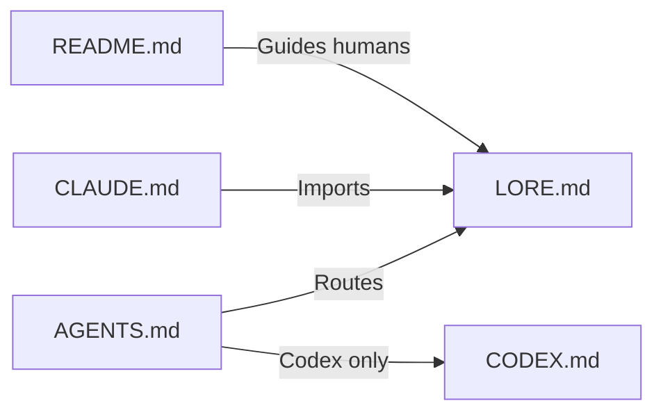

# v2.1.0

- 來源：[v2.0.0](v2.0.0.md)，包含後續 10 筆提交。

## 目錄

- [升級須知](#升級須知)
- [功能](#功能)
- [修正](#修正)
- [文件](#文件)
- [重構](#重構)
- [維護](#維護)

## 升級須知

- 本版沒有破壞性變更；bundle 名稱不變，更新 marketplace 後即可取得新版。
- `misty-work` 新增 `project-lore` skill，用來建立或整理 repo 根目錄的文件結構：

[回到目錄](#目錄)

---

## 功能

- 新增 `project-lore` skill：建立新 repo 或整理既有專案的根目錄文件，產出 `LORE.md`、`AGENTS.md`、`CLAUDE.md`、`CODEX.md` 與對應的 `_ch` 繁體中文版本，以及以「開始使用」「專案概覽」開頭的精簡 `README.md`；專案 skill 統一放在 `.agents/skills`，`.claude/skills` 是指向它的本機 link。（feat(project-lore): add skill to scaffold LORE-based root documents）

[回到目錄](#目錄)

---

## 修正

- `project-lore`：在 session 中途建立 skills link 後，必須請使用者執行 `/reload-skills`，Claude Code 才會載入其中的 skill。
- `project-lore`：移除 Cursor 規則檔的支援，並釐清 skill 的使用時機。
- 本 repo 的 `CLAUDE.md` 改為匯入 `LORE.md`，Claude Code 會自動載入共用規則。

[回到目錄](#目錄)

---

## 文件

- README 與 agent 規則改為索引式結構，「開始使用」精簡為直接加入 marketplace 網址。
- 支援的 host 移除 GitHub Copilot CLI。
- 補回 skill 目錄內連結邊界，以及 bundle 異動時同步 README Plugin Bundle 表的規則。

[回到目錄](#目錄)

---

## 重構

- 繁體中文文件後綴由 `_zhTW` 改為 `_ch`。
- 本 repo 的 `commit`、`release` skill 搬到 `.agents/skills`，`.claude/skills` 改為本機 link；移除舊的 `link-agent-skills` 腳本，`scripts/README.md` 改名為 `scripts/SCRIPTS.md`。

[回到目錄](#目錄)

---

## 維護

- Marketplace 與 Codex plugin 版本統一更新為 `2.1.0`，並僅保留最新 5 份 release note。

[回到目錄](#目錄)
