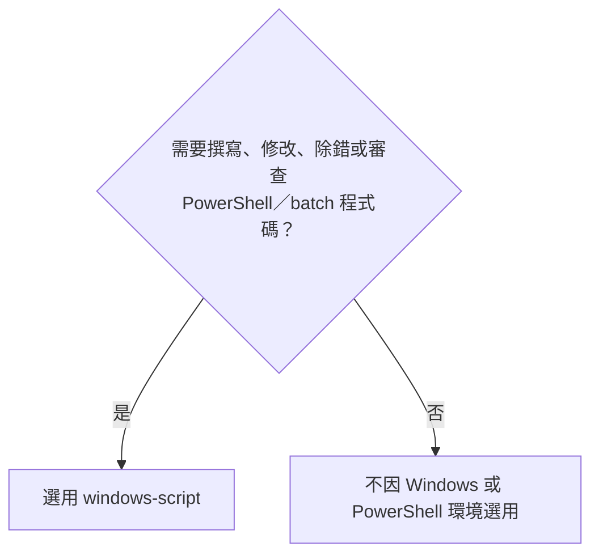

# v2.2.0

- 來源：[v2.1.0](v2.1.0.md)，包含後續 3 筆提交。

## 目錄

- [功能](#功能)
- [修正](#修正)
- [文件](#文件)
- [重構](#重構)
- [維護](#維護)

## 功能

- `project-lore`：CLAUDE 範本的 skill 捷徑只描述連結原則，由 agent 依目前作業系統與 shell 選擇連結類型及指令，並保留既有 skill 內容。
- `project-lore`：移除 repo 只能有一份根目錄 README 的限制、子目錄概覽的大寫命名要求，以及自動重新命名子目錄 README 的流程。

[回到目錄](#目錄)

---

## 修正

- `windows-script`：description 限定在任務需要撰寫、修改、除錯或審查 PowerShell／Windows batch 腳本程式碼時使用；單純操作 Windows、透過 PowerShell 執行指令或既有腳本，不構成觸發條件。CI YAML 內嵌的腳本程式碼仍在範圍內。
- `project-lore`：session 中途建立或修復 skills link 後，使用其中的 skill 前，必須請使用者依目前環境支援的方式重新載入。
- 以下為新版 description 的預期判斷邊界；本次未量測實際誤觸發率。

[回到目錄](#目錄)

---

## 文件

- 根目錄 LORE 的中英文規則同步移除 README 唯一性與子目錄命名限制。
- `project-lore` 的盤點範圍改為根目錄 README，並清理驗收中的改名敘述。

[回到目錄](#目錄)

---

## 重構

- `project-lore`：將已追蹤檔案使用 `git mv` 的搬移原則集中到流程起點，適用於所有搬移步驟。

[回到目錄](#目錄)

---

## 維護

- Marketplace 與所有 Codex plugin 版本統一更新為 `2.2.0`，並僅保留最新 5 份 release note。

[回到目錄](#目錄)
