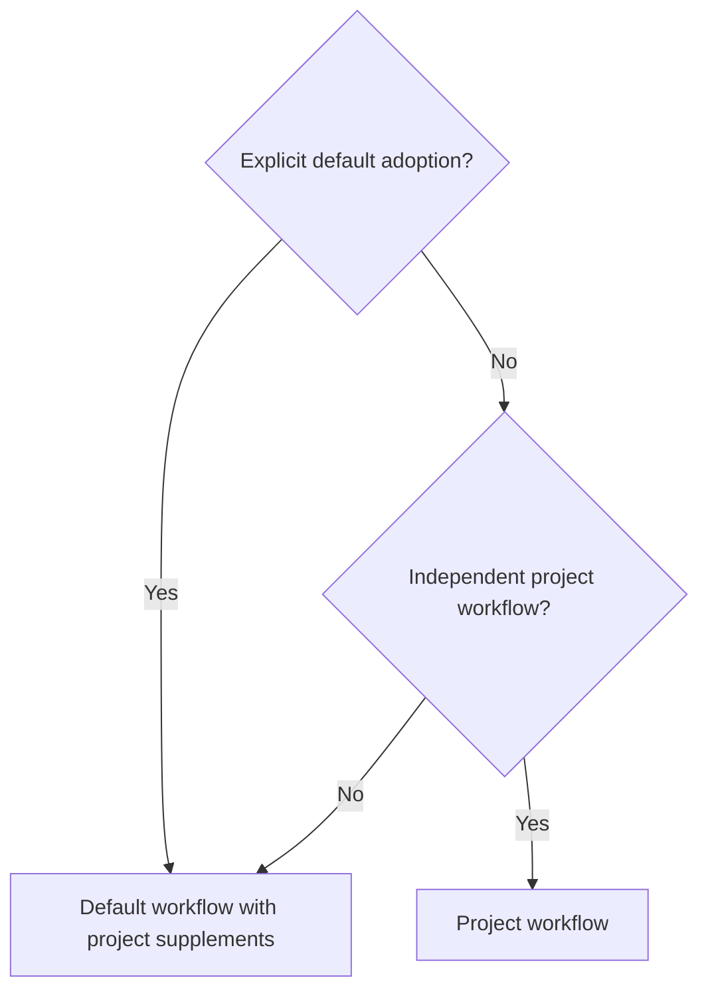

# v3.0.0

- 比較基準：[v2.2.0](v2.2.0.md)。
- 本次 major 升版的規範不相容變更是 `code-rules` 的三個業務參數上限：原本在無法分組或拆分時可保留參數，新版對可自行控制的簽章改為強制上限，仍遵循專案規則與既有一致慣例的優先順序。

## Table of Contents

- [提交與發布](#提交與發布)
- [實作規範](#實作規範)
- [文件與工具](#文件與工具)
- [相容性與遷移](#相容性與遷移)

## 提交與發布

- `misty-dev` 新增 `misty-commit` 與 `misty-release`，可在專案沒有對應指引時提供完整的提交與發布流程；專案也可明確採用預設流程，另補充版本檔、同步或驗證動作。獨立的專案流程仍優先，明確採用的規則則優先於從歷史推測的慣例。
- 預設提交指引採用 Conventional Commits 與繁體中文意圖敘述，區分提交邊界、amend、push 及 release 的授權；普通提交不會自行啟動發布。
- 預設發布流程從遠端預設分支的 first-parent 歷史尋找上一個 `vMAJOR.MINOR.PATCH` tag，依實際淨變更與相容性推薦版號。版本說明聚焦成果及遷移，附有完整範例；預設保留最新 10 份，刪除前必須取得涵蓋明確檔案清單的授權。
- 遠端整合依行為複雜度處理：意圖清楚且無取捨的簡單變更可自主整合；共享邏輯、介面或狀態的複雜交互作用必須由獨立 reviewer 審查；若行為互斥，或審查後仍無法確認兩側意圖均獲保留，停止並交由使用者決策。Git 沒有文字衝突不代表功能相容。
- 打 tag 前重新核對遠端基準與最終發布淨變更；整合使範圍、相容性或版號判斷改變時，先修正說明並確認變更決策，再發布。

[Back to top](#table-of-contents)

---

## 實作規範

- `code-rules` 明確採用「專案明文規則、既有一致慣例、語言慣例、此 skill」的優先順序。可自行控制的函式簽章最多三個業務參數，執行 context 與隱含 receiver 不列入；外部固定簽章保留原契約。獨立能力拆分函式，單一操作的多個欄位則使用有明確語意的輸入型別。
- 必填資料與值域在所有呼叫均會經過的邊界驗證；`0`、`false` 或空字串是否有效取決於契約。新增必填輸入時，必須檢查資料建構與載入來源；不能同步遷移的來源需保留相容入口，或明確說明不相容變更。
- 內部重構保留公開操作的呼叫方式與責任；初始化及依賴組裝的改變則另行檢查相容性。參數、分支、註解及 log 範例改為按任務條件載入，涵蓋輸入分組、dispatch table 與 Strategy 的適用情境。
- 型別、函式與欄位註解說明用途；只有實際存在、且名稱與宣告型別未完整表達的使用契約才補充說明。純統計 log 預設按時間或數量彙總；不能接受未記錄區間遺失時逐筆記錄，診斷或稽核事件也可供統計使用。

[Back to top](#table-of-contents)

---

## 文件與工具

- `project-lore` 將各類文件的輸出要求拆為按需讀取的 references，並在產生的 LORE 加入共用分支規則：session 開始先查分支，在 `main` 且尚無使用者選擇時詢問工作分支，同一 session 不重複詢問。既有明確的長期分支政策優先。
- `write-md` 的 AI-agent 文件規則禁止目錄、回頂連結與同文件標題錨點導覽，改用標題組織內容；人類讀者文件仍使用原有導覽規則。
- Claude bridge 的子命令支援 `--help` 與 `-h`，在檢查 Claude 環境、啟動 session 或建立 job 前顯示用法。需要傳送字面上的 help flag 時，先加 `--`；單靠引號不會繞過選項解析。
- 本 repo 的 commit/release 一律先從 local 入口載入，再委派通用流程；local release 僅補充 marketplace 版號、README 連結、既有版本說明位置與 Codex 同步驗證。

[Back to top](#table-of-contents)

---

## 相容性與遷移

1. 使用 `code-rules` 時，依實際任務檢查受控介面的業務參數數量。超過三個時，依責任拆分或建立操作輸入型別；嚴禁只為減少參數數量而掩蓋不相關責任。變更公開簽章或新增必填欄位前，檢查呼叫端與資料來源，不能假設使用 struct 就自動向後相容。
2. 新 skill 的採用說明：採用 `misty-release` 預設流程時，完整發布必須讓含該版 release note 的已驗證 commit 位於遠端預設分支的 first-parent 歷史，且 tag 直接指向該 commit。只在維護分支打 tag 的流程，需先整合至預設分支；已有獨立專案發布流程者仍遵循其流程。
3. 新 skill 的採用說明：若要保留專案自訂的提交格式、分支或發布策略，將其明確寫入專案指引；若要使用通用預設，明確委派給 `misty-commit`／`misty-release`，只補充必要的專案輸入與動作。單靠歷史慣例不會覆蓋明確採用的規則。

[Back to top](#table-of-contents)
