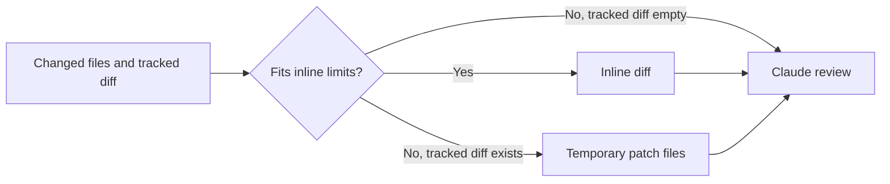

# v4.0.0

- 本版以 [v3.0.2](v3.0.2.md) 為比較基準。

## Table of Contents

- [不相容變更與升級](#不相容變更與升級)
- [功能與修正](#功能與修正)
- [維護計畫](#維護計畫)

## 不相容變更與升級

- `code-mereology` 隨附的三支腳本改用 Node.js。既有自動化需要把直譯器由 `python` 改為 `node`，並改用下列檔名。

  | 用途 | 舊檔名 | 新檔名 |
  | --- | --- | --- |
  | 計算設計文件行數 | `count_lines.py` | `count-lines.mjs` |
  | 列出尚未兌現的連結 | `list_planned.py` | `list-planned.mjs` |
  | 找出延後的模組變更計畫 | `list_plans.py` | `list-plans.mjs` |

    - 三支腳本的部分錯誤訊息文字已變更。請檢查是否有自動化比對舊版的錯誤文字。
    - 若把腳本複製到別處執行，`count-lines.mjs` 與 `list-planned.mjs` 必須與共用的 `read-lines.mjs` 放在同一目錄。
    - `list-plans.mjs` 會化簡輸出路徑中的 `..`。搜尋時會略過子目錄中的 Windows junction。若透過 junction 納入其他目錄，請把實際目錄另傳為參數。
    - `list-planned.mjs` 遇到非 UTF-8 檔案時會回報錯誤，並繼續檢查其餘檔案。

- 解析 Claude 對抗式審查的 `--json` 輸出時，把 `context.inputMode` 的超限分支由 `self-collect` 改為 `patch-files`。該分支的 `context.diffBytes` 回報實際寫入 patch 的位元組數。背景審查完成後，使用 `result --json` 從 `storedJob.result.context` 讀取相同欄位。
- `code-rules` 收緊實作規範，使用這套規則的專案升級後應依新版檢查程式碼。
    - 控制結構最多巢狀兩層，函式維持在 50 行內。三個參數的上限改以函式參數計算，仍排除執行脈絡與接收物件，並保留外部固定簽章的例外。
    - 同一目的的步驟依語意抽成函式，相關函式歸入職責明確的型別或模組。同義常數共用定義，型別以資料或職責命名。
    - 模組使用自訂輸入與輸出型別作為對外邊界，跨模組功能透過介面解耦，禁止循環相依。共用欄位或行為優先採組合，純資料型別只承載資料。
    - 函式註解須明確列出前置條件。分支持續增加且各有獨立邏輯時，封閉集合保留 `switch`，每個分支呼叫具名函式。開放集合以唯一 key 選擇分支時採用分派表。
    - 移除的規則包括撰寫前說明預期行為與驗證方式、一次變更只做一件事、優先沿用既有領域型別、不超過三個業務參數時預設保留個別參數，以及初始化與依賴組裝變更的獨立相容性檢查。新版也移除了決定介面前先檢查範例載入條件的要求，以及禁止用輸入物件掩蓋無關職責的明文條款。
    - 參數超過三個時，先檢視函式職責能否拆分。只有屬於同一範圍的參數才包裝成型別。
    - 既有專案若需要沿用舊規則，可將所需規則寫入優先適用的專案明文規範。完整條文可對照 [v3.0.2 的 code-rules](https://github.com/Aery9527/misty-marketplace/blob/v3.0.2/skills/code-rules/SKILL_ch.md) 與 [v4.0.0 的 code-rules](https://github.com/Aery9527/misty-marketplace/blob/v4.0.0/skills/code-rules/SKILL_ch.md)。
- 維護 Codex 套件需要 Node.js 22 以上。原本以 `python scripts/verify_codex_plugins.py` 驗證封裝的流程，請改用下列 Node.js 指令。

  ```sh
  node scripts/verify-codex-plugins.mjs
  node --test "scripts/tests/*.test.mjs"
  ```

[Back to top](#table-of-contents)

---

## 功能與修正

- **Claude 對抗式審查**在超過 2 個變更檔案或 256 KiB 的內嵌上限時，自動以暫存 patch 提供已追蹤檔案的完整差異，包含刪除行。工作區的檔案數計入未追蹤檔，已暫存與未暫存的差異分開保存。證據行回報交付方式與位元組數，審查摘要可交代未讀取的範圍。



- **`code-rules`** 把實作規則整理成六組可逐條審查的原則。Go 範例說明分支、參數、註解與 log 的實務取捨，運費範例也保留服務的零值行為。
- **`code-mereology`** 的組裝圖以結構角色和相依規則表示，實際模組放在下一層文件連結。新增沿用既有規則的模組時只更新連結。規劃連結檢查沿用 Python 版的 Unicode 空白比對。
- **Codex 套件同步**會在第一次寫入產物前檢查 Node.js 版本與 JSON 格式化能力，避免因缺少相依工具而只同步部分套件。JSON 格式化保留 PowerShell 序列化後交給 Node.js 的數字寫法。

[Back to top](#table-of-contents)

---

## 維護計畫

- 新增 [CLI 橋接設計與 Codex 研究清單](../docs/plan/cli-bridge-mod.md)，並將自動化 PR 流程計畫移至 [misty-pr 計畫](../docs/plan/misty-pr.md)。

[Back to top](#table-of-contents)
